# Investigasi iOS Full File System menggunakan Autopsy

Pemeriksaan menggunakan **Autopsy 4.23.1 pada Windows**, PowerShell, WinRAR, dan Python 3. Autopsy digunakan untuk ingest, penelusuran file, pembacaan tabel SQLite/plist yang dapat ditampilkan, dan ekspor bukti. Python digunakan untuk mendekode struktur tertentu serta memverifikasi hasil.

## Daftar isi

1. [Tujuan dan hasil pemeriksaan](#1-tujuan-dan-hasil-pemeriksaan)
2. [Dataset dan organisasi folder](#2-dataset-dan-organisasi-folder)
3. [Persiapan dan verifikasi integritas](#3-persiapan-dan-verifikasi-integritas)
4. [Pembuatan kasus dan pemilihan sumber data](#4-pembuatan-kasus-dan-pemilihan-sumber-data)
5. [Pemilihan Ingest Modules](#5-pemilihan-ingest-modules)
6. [Kendala ingest dan perbaikan ekstraksi](#6-kendala-ingest-dan-perbaikan-ekstraksi)
7. [Teknik penelusuran dan ekspor bukti](#7-teknik-penelusuran-dan-ekspor-bukti)
8. [Analisis delapan pertanyaan](#8-analisis-delapan-pertanyaan)
9. [Artefak dan operasi yang tidak berhasil diproses](#9-artefak-dan-operasi-yang-tidak-berhasil-diproses)
10. [Integritas file dan penyimpanan Git](#10-integritas-file-dan-penyimpanan-git)
11. [Indeks dokumentasi dan batas kesimpulan](#11-indeks-dokumentasi-dan-batas-kesimpulan)
12. [Referensi teknis](#12-referensi-teknis)

## 1. Tujuan dan hasil pemeriksaan

Tugas Autopsy mencakup membuka dataset, menjalankan ingest, mengidentifikasi artefak yang tidak dapat diparse dengan berhasil, dan menyimpan screenshot sebagai bukti. Delapan pertanyaan kasus digunakan sebagai sasaran pencarian bukti.

| No. | Pertanyaan | Hasil | Metode utama |
|---|---|---|---|
| 1 | Berapa barang pada daftar belanja Patrick? | **4**: Energy drinks, Bread, Hand soap, Birthday card | Autopsy + SQL + Python untuk dekompresi BLOB |
| 2 | Lokasi terakhir ponsel? | **38.84412765, -77.28686523**; catatan 14 Februari 2022, 18:26:03.105048 UTC | Autopsy + query SQLite dengan WAL |
| 3 | Kapan reboot terakhir? | Log mendeteksi reboot **14 Februari 2022, 11:44:13**; zona waktu belum terverifikasi | Penelusuran Autopsy + pencarian teks PowerShell |
| 4 | Waktu pembuatan akun Reddit? | **21 Januari 2022, 21:59:38 UTC**, username **PogProgrammer** | Autopsy + dekode NSKeyedArchiver menggunakan Python |
| 5 | Aplikasi yang dihapus? | **WeChat**, bundle identifier `com.tencent.xin` | Autopsy + korelasi teks log PowerShell |
| 6 | Isi notifikasi Reddit terakhir? | **Kornbread and Jorgeous are still Making Fun of Cynthia's Car Crash...** | Pemetaan folder aplikasi + dekode plist + pemilihan timestamp maksimum |
| 7 | Suara alarm yang dipilih? | **Radar**, nilai `system:Radar` | Plist viewer Autopsy + verifikasi Python |
| 8 | Nama GIF yang diterima melalui Bumble? | **thirsty steve martin GIF**, ID `cXCVTR1wUn1a8` | Autopsy + SQL + dekode BLOB + verifikasi halaman GIPHY |

**Batas interpretasi:** koordinat merupakan entri terbaru dalam tabel lokasi yang diperiksa, dengan estimasi akurasi horizontal 1.414 meter. Waktu pada log reboot adalah waktu pendeteksian, bukan bukti mandiri waktu kernel mulai menyala. Judul GIF berasal dari halaman GIPHY saat pemeriksaan, sedangkan database menyimpan tautannya.

## 2. Dataset dan organisasi folder

Sumber dataset: [Digital Corpora, 2022 CTF - iOS Full File System.zip](https://digitalcorpora.s3.amazonaws.com/corpora/scenarios/magnet/2022%20CTF%20-%20iOS%20Full%20File%20System.zip).

Arsip unduhan memuat folder `Jess_CTF_iPhone8` dan ZIP internal:

```text
fb028ddefa8af7df5b12d3e729f075d150637a31_files_full.zip
```

Nama folder `Jess_CTF_iPhone8` dipertahankan sesuai dataset. Identitas Patrick dikaitkan dengan informasi perangkat dan artefak kasus, bukan disimpulkan dari nama folder. Informasi akuisisi menyebut iPhone 8 dengan iOS 15.0.2. Ekstraksi Full File System menyediakan file dan direktori iOS, bukan citra sektor fisik seluruh media penyimpanan.

| Lokasi relatif dari `01_Autopsy` | Fungsi |
|---|---|
| `00_Raw/` | ZIP unduhan asli |
| `01_Extracted/Jess_CTF_iPhone8/` | Hasil ekstraksi arsip luar, ZIP internal, dan berkas pendamping akuisisi |
| `02_Case/Assignment2_iOS_Autopsy/` | Database kasus, hasil ingest, indeks, log, dan folder keluaran Autopsy |
| `03_Dokumentasi/` | Screenshot dan catatan hash |
| `04_Export/` | File bukti yang diekspor dan skrip pendamping |
| `README.md` | Dokumentasi pemeriksaan ini |

Folder kerja ekstraksi iOS yang berhasil di-ingest berada di **`C:\DF_A2\iOS_CaseSensitive`**, di luar folder repository. Autopsy mereferensikan sumber data tersebut; folder kasus bukan salinan pengganti seluruh sumber. Karena itu, memindahkan/menghapus folder sumber dapat memutus akses kasus.

## 3. Persiapan dan verifikasi integritas

### 3.1 Hash ZIP unduhan asli

SHA-256 digunakan untuk mencatat sidik digital byte arsip sebelum ekstraksi. Hash mendukung pemeriksaan apakah file berubah; hash saja tidak membuktikan kebenaran seluruh isi atau identitas pemiliknya. Arsip luar dan ZIP internal merupakan dua file berbeda sehingga hash-nya tidak diharapkan sama.

Perintah yang digunakan:

```powershell
Set-Location -LiteralPath 'C:\Users\ASUS ZENBOOK\Documents\DapuntaXD\All About ITS\Semester 7\Forensik Digital\Tugas\DigitalForensics_Assignment2\01_Autopsy\00_Raw'

Get-FileHash -LiteralPath '.\2022 CTF - iOS Full File System.zip' -Algorithm SHA256 | Format-List | Tee-Object -FilePath '..\03_Dokumentasi\00_SHA256_ZIP.txt'
```

`-LiteralPath` memperlakukan path sebagai nama persis, termasuk spasi. `Format-List` menampilkan algoritma, hash, dan path. `Tee-Object` menyimpan hasil sambil tetap menampilkannya di terminal. Folder `03_Dokumentasi` sudah disiapkan sebelum perintah dijalankan.

Nilai hash arsip luar mengacu pada [00_SHA256_ZIP.txt](03_Dokumentasi/00_SHA256_ZIP.txt), tidak disalin ulang tanpa memeriksa catatan aslinya.

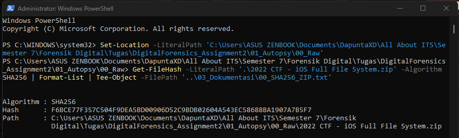

### 3.2 Ekstraksi arsip luar dan hash ZIP internal

Arsip dibuka menggunakan WinRAR dan diekstrak ke `01_Extracted`. Isinya diperiksa sebelum ZIP internal dijadikan sumber data. Membuka arsip tidak sama dengan menjalankan aplikasi yang mungkin ada di dalamnya.

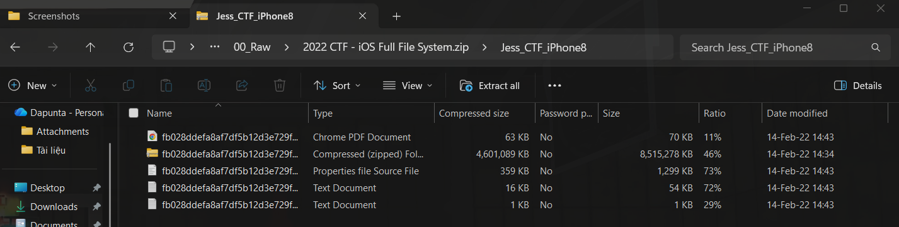

Perintah hash ZIP internal:

```powershell
Set-Location -LiteralPath 'C:\Users\ASUS ZENBOOK\Documents\DapuntaXD\All About ITS\Semester 7\Forensik Digital\Tugas\DigitalForensics_Assignment2\01_Autopsy\01_Extracted\Jess_CTF_iPhone8'

Get-FileHash -Path '.\*.zip' -Algorithm SHA256 | Format-List | Tee-Object -FilePath '..\..\03_Dokumentasi\03_SHA256_ZIP_Internal.txt'
```

`-Path '.\*.zip'` sengaja memakai wildcard untuk memilih ZIP pada folder tersebut. Bila ada lebih dari satu ZIP, hasil harus dicocokkan berdasarkan nama file.

SHA-256 ZIP internal yang diperiksa:

```text
a6d180aff36c9b37ec9a3819f3d98af46efc9c47b36a8a7b58cde791049b38c2
```

Nilai tersebut cocok dengan hash yang dicantumkan pada dokumen akuisisi. Catatan lokal disimpan dalam [03_SHA256_ZIP_Internal.txt](03_Dokumentasi/03_SHA256_ZIP_Internal.txt).

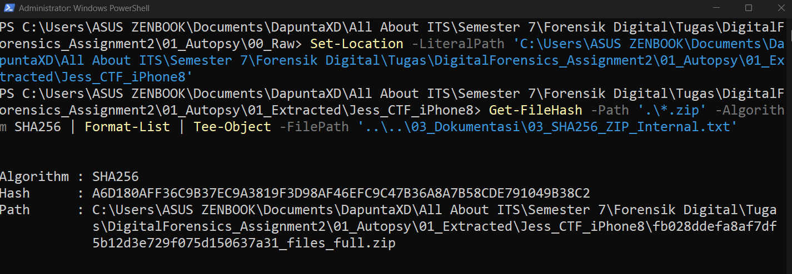

### 3.3 Verifikasi arsip dengan WinRAR

Ekstraksi melalui fasilitas ZIP Windows mengalami kendala. Arsip kemudian diuji menggunakan fungsi **Test** pada WinRAR. Pengujian berakhir tanpa error. Hasil ini mendukung bahwa arsip dapat dibaca oleh WinRAR, tetapi tidak menjamin setiap parser Autopsy akan berhasil mengolahnya.

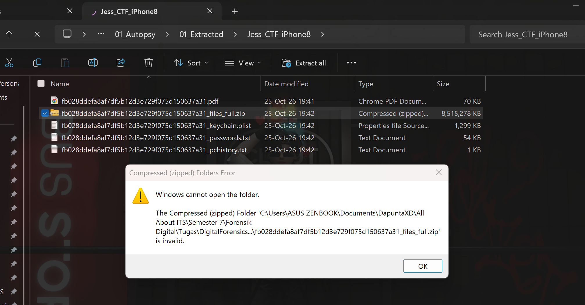

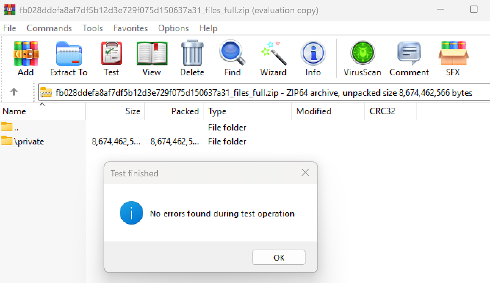

## 4. Pembuatan kasus dan pemilihan sumber data

### 4.1 Membuat kasus

1. Membuka Autopsy dan memilih pembuatan kasus baru.
2. Menggunakan nama kasus `Assignment2_iOS_Autopsy`.
3. Menempatkan kasus dalam `01_Autopsy\02_Case`.
4. Menggunakan kasus lokal untuk pemeriksaan pada satu komputer.
5. Menambahkan sumber data setelah kasus dibuat.

Folder kasus dipisahkan dari arsip asli agar database kasus, indeks, dan hasil modul tidak bercampur dengan sumber bukti.

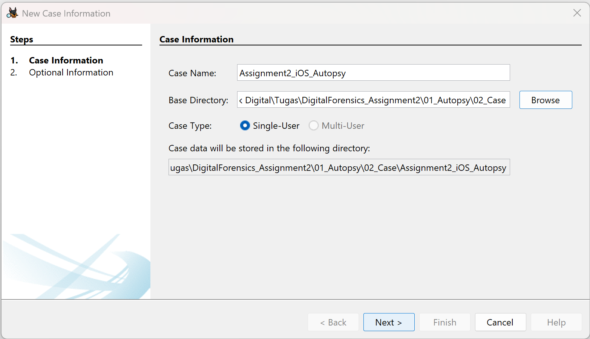

### 4.2 Mengapa memilih Logical Files?

Dataset yang tersedia adalah ZIP berisi struktur file iOS. Oleh sebab itu, **Logical Files** sesuai untuk menambahkan ZIP sebagai file lokal pada percobaan pertama dan folder hasil ekstraksi pada percobaan kedua. ZIP tidak diubah namanya menjadi `.img` karena penggantian ekstensi tidak mengubah struktur datanya.

| Jenis sumber data | Masukan dan kegunaan | Kesesuaian untuk kasus ini |
|---|---|---|
| **Disk Image or VM File: disk image** | Citra media, misalnya RAW/DD atau E01; dapat membawa struktur partisi dan file system | Dataset yang disediakan bukan citra sektor jenis ini |
| **Disk Image or VM File: VM disk** | Disk virtual seperti VMDK atau VHD/VHDX; bukan sekadar file konfigurasi VM | Tidak tersedia disk virtual pada kasus |
| **Local Disk** | Perangkat penyimpanan yang tersambung langsung, misalnya disk atau USB | Laptop pemeriksa bukan perangkat bukti iPhone |
| **Logical Files** | File/folder lokal yang ditambahkan sebagai kumpulan berkas | Dipilih untuk ZIP internal dan folder ekstraksi |
| **Unallocated Space Image File** | Data mentah tanpa struktur file system yang hendak diproses sebagai ruang data | Tidak sesuai dengan direktori iOS yang sudah diekstrak |
| **Autopsy Logical Imager Results** | Keluaran dari Autopsy Logical Imager | Dataset bukan keluaran alat tersebut |
| **XRY Text Export** | Ekspor teks dari XRY | Dataset bukan ekspor XRY |

Pada Logical Files, pemeriksaan berfokus pada file yang disediakan. Metode ini tidak menyediakan analisis ruang kosong media fisik iPhone atau pemulihan semua file yang terhapus.

Referensi perbedaan jenis sumber: [dokumentasi Data Sources Autopsy](https://sleuthkit.org/autopsy/docs/user-docs/4.23.0/ds_page.html).

### 4.3 Timestamp dan host

Timestamp dari file system komputer pemeriksa tidak dipakai sebagai waktu kejadian iPhone. File hasil ekstraksi dapat memperoleh timestamp saat disalin. Karena timestamp lokal tidak diikutkan, beberapa kolom Autopsy menampilkan `0000-00-00 00:00:00`; tampilan itu bukan bukti bahwa database rusak.

Waktu kejadian diturunkan dari isi artefak: timestamp SQLite, `NSDate`, dan teks log. Sumber kedua dikaitkan dengan host yang sama karena keduanya berasal dari akuisisi perangkat yang sama. Sumber pertama dan kedua tidak diperlakukan sebagai dua ponsel berbeda.

## 5. Pemilihan Ingest Modules

Ingest adalah pemrosesan otomatis terhadap sumber data: pengenalan format, ekstraksi teks, pencarian artefak, dan pengindeksan. Modul dipilih menurut tujuan pemeriksaan, bukan dengan asumsi bahwa semua format iOS pasti didukung.

| Modul | Tujuan | Alasan dipilih dan batasnya |
|---|---|---|
| **Recent Activity** | Menemukan aktivitas pengguna dan artefak web yang didukung | Memberi titik awal dari hasil terstruktur; tidak menjamin semua aplikasi iOS terurai. Web History dalam soal dicakup melalui dukungan artefak web modul ini, bukan diasumsikan sebagai checkbox terpisah |
| **File Type Identification** | Mengenali format dari isi/signature | Membantu membedakan SQLite, plist, gambar, arsip, dan file tanpa ekstensi |
| **Extension Mismatch Detector** | Membandingkan ekstensi dan jenis file | Menandai ketidaksesuaian; mismatch bukan bukti tunggal aktivitas berbahaya |
| **Embedded File Extractor** | Mengekstrak isi arsip dan file tersemat yang didukung | Diperlukan saat ZIP ditambahkan sebagai file; hasil ekstraksi diteruskan ke ingest. Modul tetap dipilih pada sumber kedua untuk arsip lain di dalam dataset |
| **Picture Analyzer** | Mengekstrak metadata gambar yang didukung | EXIF dapat memuat informasi waktu/lokasi bila tersedia; tidak semua gambar memiliki GPS |
| **Keyword Search** | Mengekstrak dan mengindeks teks | Mendukung pencarian kata, nama aplikasi, dan log. BLOB terkompresi atau struktur khusus belum tentu dapat dicari sebagai teks |
| **Email Parser** | Memeriksa format penyimpanan email yang didukung | Memperluas pencarian komunikasi. Pemilihan modul tidak membuktikan email relevan ditemukan |
| **Encryption Detection** | Menandai indikasi file terenkripsi | Menjadi petunjuk pemeriksaan lanjut, bukan alat dekripsi otomatis |

**iOS Analyzer (iLEAPP)** turut diaktifkan pada percobaan pertama, tetapi log mencatat modul melewati sumber. Pada sumber kedua berupa folder hasil ekstraksi, modul ini tidak diaktifkan. Dokumentasi integrasi menyebut pemrosesan `.tar/.zip`; kegagalan identifikasi sumber pertama dicatat sebagai keadaan yang diamati, bukan disimpulkan bahwa dataset bukan iOS.

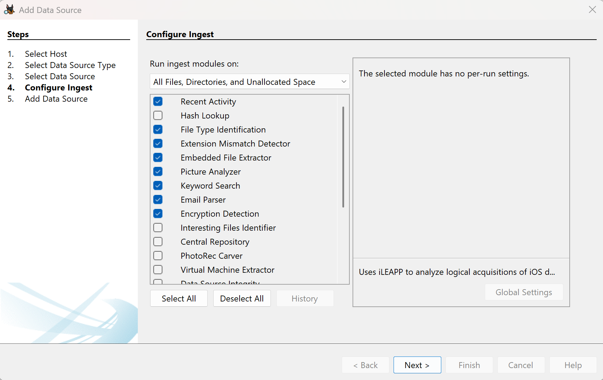

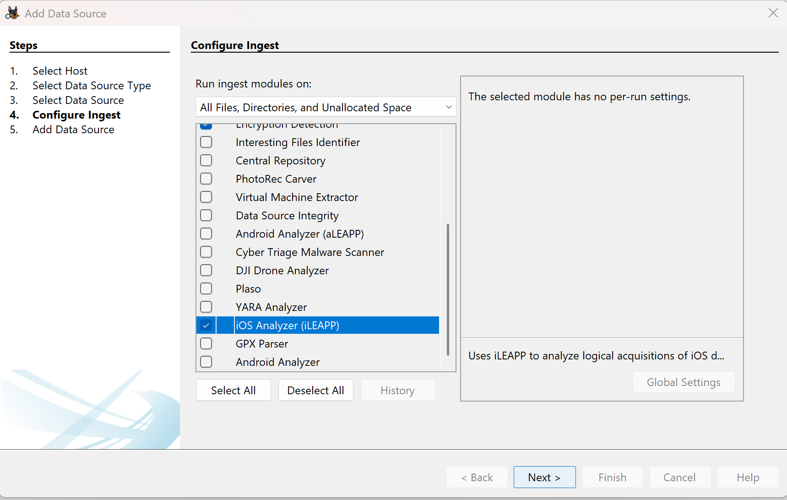

## 6. Kendala ingest dan perbaikan ekstraksi

### 6.1 Percobaan pertama: ZIP internal

ZIP internal ditambahkan melalui Logical Files sebagai **LogicalFileSet1**. Ingest mulai 25 Oktober 2026 sekitar **20:53 WIB**. Log mencatat iOS Analyzer dilewati pada 20:53:04 dan kegagalan unpack ZIP pada 20:57:04.

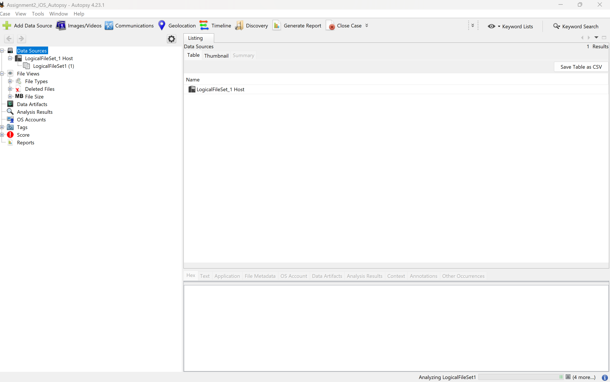

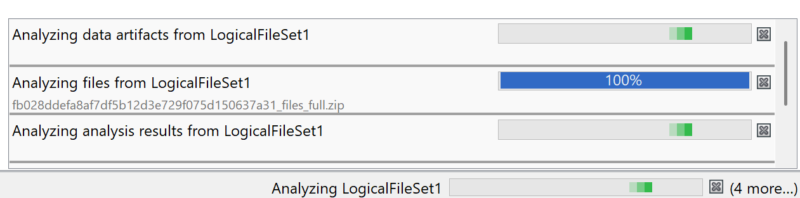

Log dan pesan Autopsy menunjukkan:

```text
Error unpacking file: ... fb028ddefa8af7df5b12d3e729f075d150637a31_files_full.zip
net.sf.sevenzipjbinding.SevenZipException
java.lang.ArrayIndexOutOfBoundsException: Index -1745239881 out of bounds for length 131072
java.lang.IllegalStateException: Unexpected IOException
```

`autopsy.log.2` yang diperiksa berisi **528 baris peringatan `encountered error DATAERROR`** pada percobaan ini. Jumlah tersebut adalah jumlah baris peringatan, bukan jumlah 528 artefak unik yang telah dipetakan ke nama file sumber.

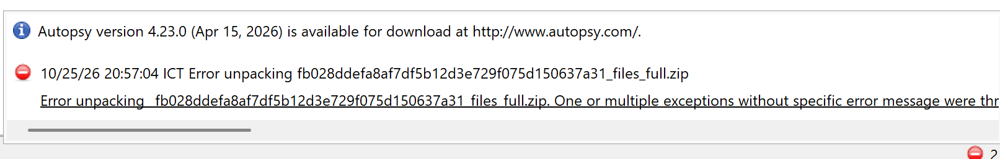

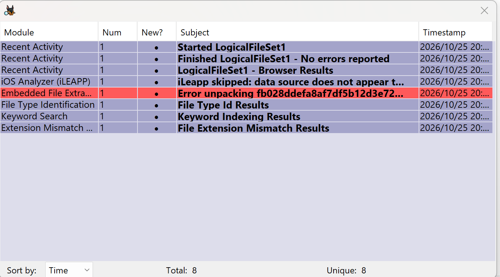

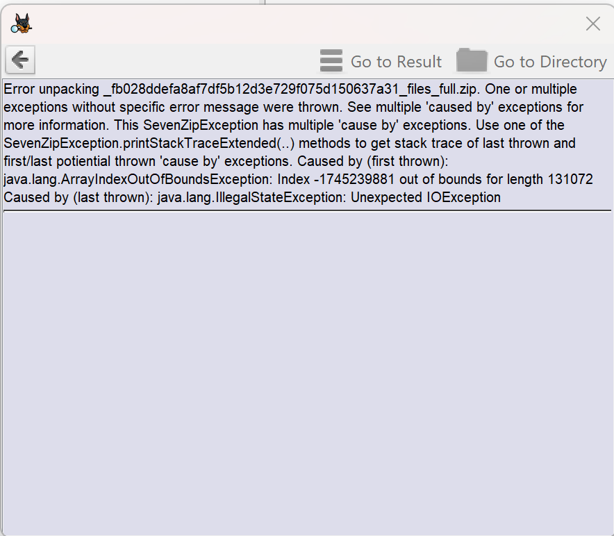

Pesan modul iOS:

```text
iLeapp: data source does not appear to be iOS, skipping.
```

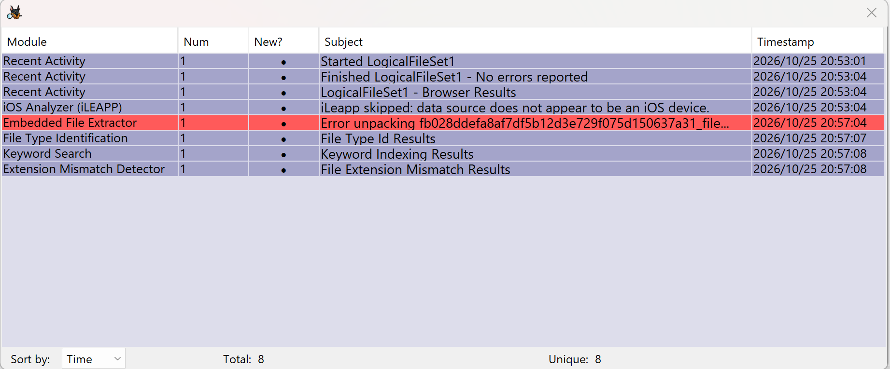

**Kesimpulan terbatas:** ekstraktor arsip Autopsy gagal pada percobaan pertama dan modul iOS tidak melakukan parsing. Penyebab internal exception belum dipastikan. Hasil Test WinRAR dan hash tidak mendukung menyimpulkan arsip pasti rusak. Konflik kapitalisasi saat ekstraksi manual juga tidak otomatis membuktikan penyebab `SevenZipException`.

### 6.2 Ekstraksi manual dan konflik kapitalisasi

Ekstraksi manual awal di `C:\DF_A2\iOS_Files` menghadapi dua nama berbeda dalam direktori yang sama:

```text
private/var/mobile/Library/Preferences/com.apple.preferences.plist
private/var/mobile/Library/Preferences/com.apple.Preferences.plist
```

Keduanya berbeda huruf kapital dan ukuran: **42 byte** serta **1.599 byte**. Pada direktori Windows yang tidak membedakan kapitalisasi, nama itu berpotensi berbenturan. Menimpa salah satu file akan menghilangkan salah satu artefak dari salinan kerja. Ekstraksi parsial tersebut tidak digunakan sebagai sumber analisis utama.

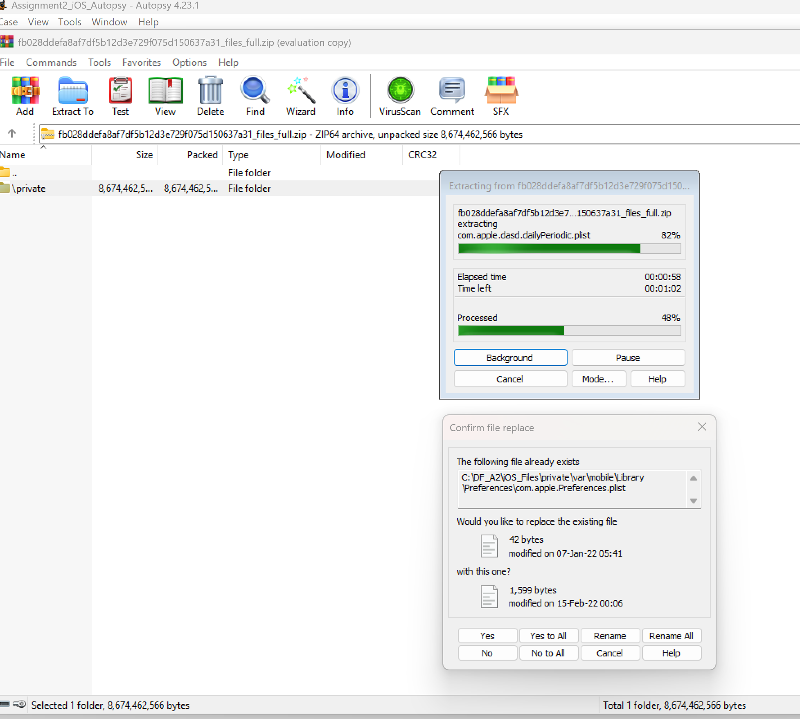

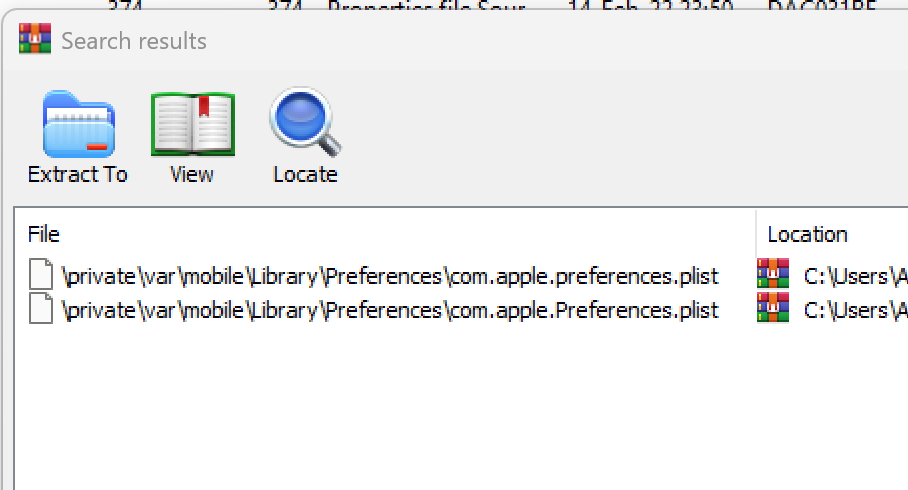

Folder baru dibuat dan diberi atribut case-sensitive sebelum ekstraksi ulang. Bentuk perintah untuk mereproduksi pengaturan, dijalankan pada PowerShell Administrator:

```powershell
New-Item -ItemType Directory -Path 'C:\DF_A2\iOS_CaseSensitive' -Force
fsutil.exe file setCaseSensitiveInfo 'C:\DF_A2\iOS_CaseSensitive' enable
fsutil.exe file queryCaseSensitiveInfo 'C:\DF_A2\iOS_CaseSensitive'
```

Pengaturan berlaku pada lingkungan kerja NTFS yang mendukungnya. Hasil query diperiksa, kemudian ZIP internal diekstrak kembali dengan WinRAR ke folder tersebut. Dua file diverifikasi tetap ada secara terpisah. Flag pada folder kosong dipasang sebelum pembuatan subfolder; keberhasilan tetap diperiksa melalui hasil ekstraksi, bukan diasumsikan dari perintah saja.

```powershell
Get-ChildItem -LiteralPath 'C:\DF_A2\iOS_CaseSensitive\private\var\mobile\Library\Preferences' |
    Where-Object { $_.Name -ceq 'com.apple.preferences.plist' -or $_.Name -ceq 'com.apple.Preferences.plist' } |
    Select-Object Name, Length
```

`-ceq` membandingkan string dengan membedakan huruf besar dan kecil.

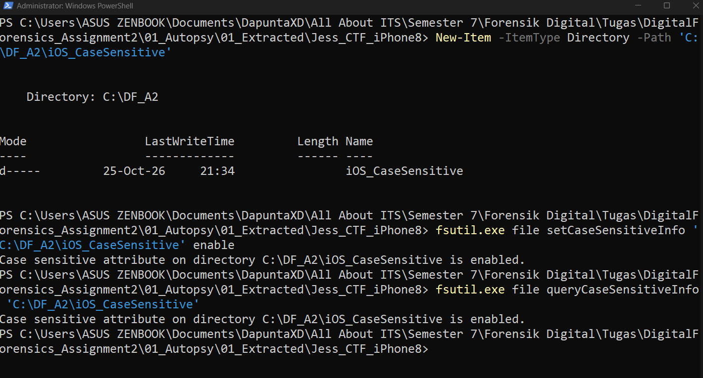

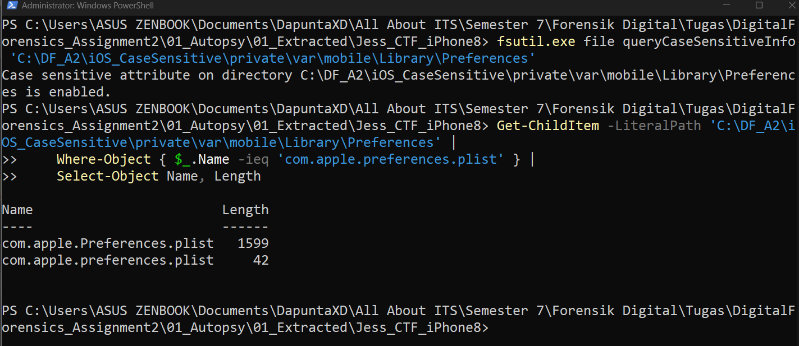

### 6.3 Percobaan kedua: folder hasil ekstraksi

1. Pada kasus yang sama, memilih **Add Data Source**.
2. Menggunakan host yang sama dan memilih **Logical Files**.
3. Menambahkan `C:\DF_A2\iOS_CaseSensitive` sebagai **LogicalFileSet2**.
4. Tidak menyertakan timestamp lokal komputer pemeriksa.
5. Menjalankan delapan modul umum pada tabel sebelumnya; iOS Analyzer tidak diaktifkan.
6. Menunggu ingest selesai, memeriksa pesan, dan menyimpan log.

| Peristiwa | Waktu pemeriksaan lokal, WIB |
|---|---|
| Ingest pertama dimulai | 25 Oktober 2026, sekitar 20:53 |
| Ingest kedua dimulai | 25 Oktober 2026, 22:18:05 |
| Recent Activity sumber kedua selesai | 25 Oktober 2026, 22:18:22 |
| Seluruh tugas ingest kedua selesai menurut log | 26 Oktober 2026, 05:18:27 |
| Penyelesaian diamati oleh pemeriksa | 26 Oktober 2026, 05:21 |

Waktu di atas adalah waktu aktivitas pemeriksa tahun 2026. Kejadian dalam bukti ponsel berasal dari tahun 2022. Keduanya tidak dicampur menjadi satu kronologi perangkat.

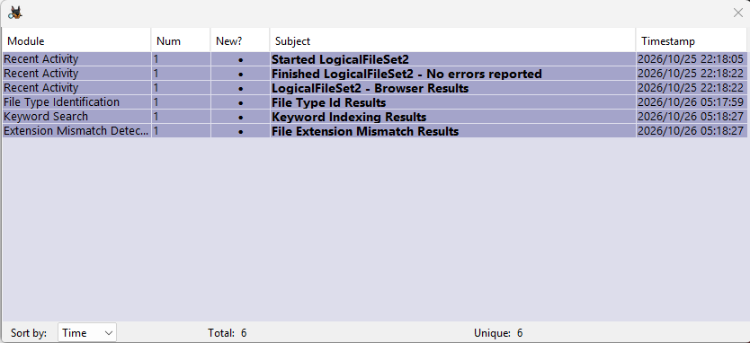

Log mencatat 91.062 file terindeks dan 120.467 potongan indeks. Ringkasan beberapa penghitung error bernilai nol, tetapi log rinci tetap memuat peringatan dan exception. Oleh sebab itu, persentase 100% dan pesan selesai **tidak membuktikan seluruh artefak berhasil diparse**.

## 7. Teknik penelusuran dan ekspor bukti

### 7.1 File Search, Keyword Search, dan viewer

- **Tools → File Search by Attributes** digunakan untuk menemukan nama file seperti `NoteStore.sqlite`, `Cache.sqlite`, atau `com.apple.mobiletimerd.plist`.
- **Keyword Search** digunakan untuk mencari isi teks yang terindeks. Hasil kata umum seperti `shopping` juga memunculkan resource aplikasi dan cache yang tidak relevan; kecocokan kata belum menjadi bukti daftar belanja.
- **Data Sources → LogicalFileSet2** digunakan untuk menelusuri struktur direktori dan memastikan asal artefak.
- **Application** pada panel bawah digunakan untuk tabel SQLite atau plist yang dapat ditampilkan.
- **Text/Hex** dapat membantu mengamati byte/teks, tetapi munculnya string tidak sama dengan berhasil mendekode struktur aplikasi.

Sumber utama temuan adalah **LogicalFileSet2**, bukan hasil ekstraksi gagal dari LogicalFileSet1.

### 7.2 Ekspor file

Pada file terpilih, **klik kanan → Extract File(s)** digunakan untuk menyimpan salinan ke subfolder `04_Export` yang sesuai. Prefix numerik hasil ekspor, misalnya `73029-Chat.sqlite`, merupakan identitas ekspor Autopsy, bukan bagian dari nama asli file iOS.

Untuk SQLite, file utama, `-wal`, dan `-shm` diekspor bersama bila tersedia:

| File | Fungsi dalam pemeriksaan |
|---|---|
| `.sqlite` / `.db` | File database utama |
| `-wal` | Write-ahead log; dapat membawa transaksi yang belum masuk ke file utama |
| `-shm` | Pendamping shared-memory/index WAL; dipertahankan bersama paket bukti |

Membuka database tanpa WAL dapat menghasilkan keadaan yang berbeda. Skrip menyalin paket ekspor ke direktori sementara, mengembalikan nama pasangan yang konsisten, lalu membuka SQLite dengan `mode=ro`. File unggahan/ekspor tidak diganti nama atau dibuka untuk penulisan. Hash sebelum dan sesudah dipakai untuk memeriksa bahwa file ekspor tidak berubah. `PRAGMA integrity_check` memeriksa struktur SQLite, bukan membuktikan seluruh interpretasi aplikasi benar.

### 7.3 Menjalankan kode pendamping

Kode Python pada bagian berikut adalah **versi reproduksi yang diuji kembali pada salinan bukti ekspor**, dengan hasil inti yang sama dengan screenshot pemeriksaan. Tata letak output dapat berbeda dari versi skrip yang lebih awal. Skrip tidak mengambil jawaban dari internet atau memasukkan hasil secara hardcoded.

Setiap kode disimpan dengan nama yang disebutkan di subfolder bukti terkait, lalu dijalankan dari sana:

```powershell
python .\periksa_notes.py
```

Jika instalasi Windows menggunakan Python Launcher, perintah setara adalah `py .\periksa_notes.py`. Semua skrip menggunakan pustaka standar Python; tidak membutuhkan `pip install`.

## 8. Analisis delapan pertanyaan

### 8.1 Daftar belanja Patrick

**Jawaban: 4 barang.**

**Artefak sumber:**

```text
private/var/mobile/Containers/Shared/AppGroup/B7A0EA29-86E3-464A-B2A4-D4199FAD7FA5/NoteStore.sqlite
```

Pendamping: `NoteStore.sqlite-wal` dan `NoteStore.sqlite-shm` pada direktori yang sama.

**Proses:**

1. Pencarian kata belanja tidak langsung menghasilkan catatan yang dimaksud; hasil juga berisi teks resource yang tidak relevan.
2. File Search digunakan untuk menemukan `NoteStore.sqlite`, lalu lokasi AppGroup diperiksa.
3. Pada Application, tabel `ZICCLOUDSYNCINGOBJECT` menampilkan catatan berjudul **Grocery list**. Barisnya memiliki `Z_PK = 4` dan `ZNOTEDATA = 1`.
4. Tabel `ZICNOTEDATA` memuat isi pada `ZDATA`, tetapi viewer menampilkan BLOB, bukan daftar barang.
5. Database dan pendamping diekspor ke `04_Export/Notes`.
6. Query menghubungkan `ZICCLOUDSYNCINGOBJECT.ZNOTEDATA` dengan `ZICNOTEDATA.Z_PK`.
7. Python mendekompresi GZIP pada `ZDATA`, mengambil rentang teks daftar, lalu memisahkan baris. Judul **Grocery list** dikeluarkan dari hitungan.

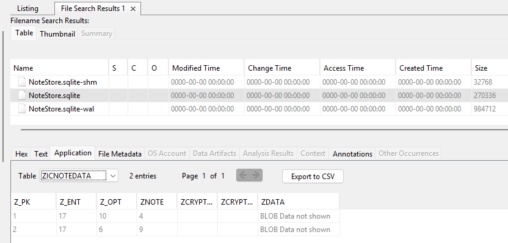

**Kode `04_Export/Notes/periksa_notes.py`:**

```python
from pathlib import Path
import hashlib
import shutil
import sqlite3
import tempfile
import gzip
import re

files = {"78909-NoteStore.sqlite": "NoteStore.sqlite",
         "78910-NoteStore.sqlite-shm": "NoteStore.sqlite-shm",
         "78911-NoteStore.sqlite-wal": "NoteStore.sqlite-wal"}
dbname = "NoteStore.sqlite"

folder = Path(__file__).resolve().parent

def hashes():
    return {name: hashlib.sha256((folder / name).read_bytes()).hexdigest()
            for name in files}

before = hashes()
print("SHA-256 file hasil ekspor:")
for name, digest in before.items():
    print(name, digest)
with tempfile.TemporaryDirectory() as temp:
    work = Path(temp)
    for source, target in files.items():
        shutil.copy2(folder / source, work / target)
    connection = sqlite3.connect((work / dbname).as_uri() + "?mode=ro", uri=True)
    try:
        print("Integritas SQLite:", connection.execute("PRAGMA integrity_check").fetchone()[0])
        query = """SELECT o.Z_PK, d.Z_PK, d.ZDATA
                   FROM ZICCLOUDSYNCINGOBJECT o
                   JOIN ZICNOTEDATA d ON o.ZNOTEDATA = d.Z_PK
                   WHERE o.ZTITLE1 = ?"""
        row = connection.execute(query, ("Grocery list",)).fetchone()
        if row is None:
            raise RuntimeError("Catatan Grocery list tidak ditemukan")
        decoded = gzip.decompress(row[2])
        match = re.search(rb"Grocery list[^\x00-\x08\x0b-\x1f\x7f]*", decoded)
        if match is None:
            raise RuntimeError("Teks daftar tidak ditemukan setelah dekompresi")
        lines = [line.strip() for line in match.group().decode("utf-8").splitlines()
                 if line.strip()]
        print("Z_PK catatan:", row[0], "Z_PK data:", row[1])
        print("Judul:", lines[0])
        for index, item in enumerate(lines[1:], 1):
            print(f"{index}. {item}")
        print("Jumlah barang:", len(lines) - 1)
    finally:
        connection.close()
print("Hash file ekspor tetap sama:", before == hashes())
```

Hasil: **Energy drinks**, **Bread**, **Hand soap**, **Birthday card**. Jumlah baris barang = **4**.

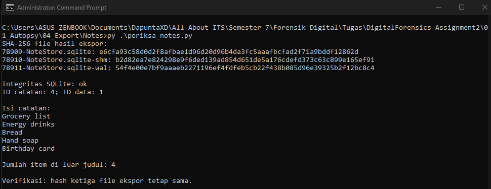

**Metode dan keterbatasan:** Autopsy menemukan file dan membaca tabel, sedangkan Python membuka kompresi BLOB. Ekstraksi teks ini khusus untuk catatan yang diperiksa; bukan parser protobuf lengkap, tidak menafsirkan seluruh format rich text, dan tidak menentukan apakah setiap item sudah dicentang.

### 8.2 Lokasi terakhir ponsel

**Jawaban: latitude `38.84412765`, longitude `-77.28686523`.**

Artefak:

```text
private/var/mobile/Library/Caches/com.apple.routined/Cache.sqlite
Tabel: ZRTCLLOCATIONMO
```

**Proses:**

1. Tampilan Geolocation tidak menyediakan artefak lokasi terstruktur untuk sumber yang dipilih. Koordinat kursor pada peta tidak digunakan sebagai posisi ponsel.
2. `com.apple.routined.plist` diperiksa, tetapi file preferensi tersebut tidak langsung memberikan pasangan koordinat terakhir.
3. Penelusuran beralih ke cache layanan `com.apple.routined` dan tabel `ZRTCLLOCATIONMO`.
4. Autopsy menampilkan **4.084 entri**. Database bersama WAL/SHM diekspor ke `04_Export/Routined`.
5. Query memilih nilai `ZTIMESTAMP` terbesar. Pengurutan kedua berdasarkan `Z_PK` membuat pemilihan stabil bila timestamp sama.
6. Timestamp diinterpretasikan sebagai detik sejak **1 Januari 2001 UTC**, lalu dikonversi ke kalender UTC.

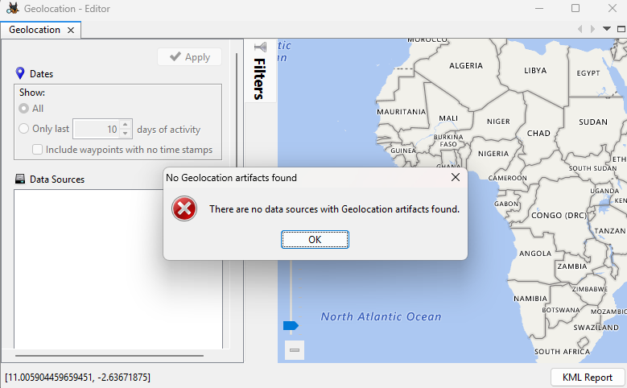

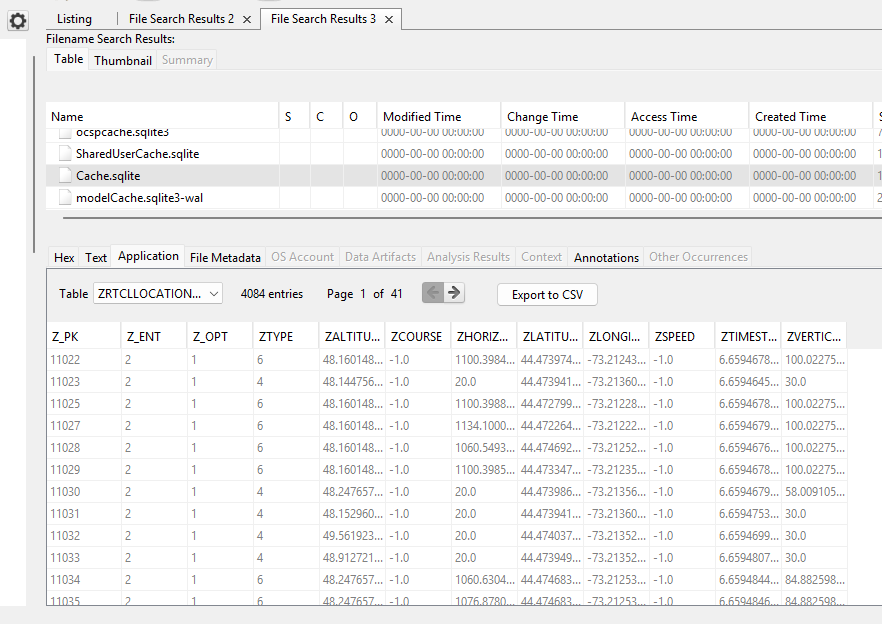

**Kode `04_Export/Routined/periksa_lokasi.py`:**

```python
from pathlib import Path
import hashlib
import shutil
import sqlite3
import tempfile
from datetime import datetime, timedelta, timezone

files = {name: name for name in ("Cache.sqlite", "Cache.sqlite-shm", "Cache.sqlite-wal")}
dbname = "Cache.sqlite"

folder = Path(__file__).resolve().parent

def hashes():
    return {name: hashlib.sha256((folder / name).read_bytes()).hexdigest()
            for name in files}

before = hashes()
print("SHA-256 file hasil ekspor:")
for name, digest in before.items():
    print(name, digest)
with tempfile.TemporaryDirectory() as temp:
    work = Path(temp)
    for source, target in files.items():
        shutil.copy2(folder / source, work / target)
    connection = sqlite3.connect((work / dbname).as_uri() + "?mode=ro", uri=True)
    try:
        print("Integritas SQLite:", connection.execute("PRAGMA integrity_check").fetchone()[0])
        print("Jumlah lokasi:", connection.execute("SELECT COUNT(*) FROM ZRTCLLOCATIONMO").fetchone()[0])
        query = """SELECT Z_PK, ZTIMESTAMP, ZLATITUDE, ZLONGITUDE,
                          ZHORIZONTALACCURACY, ZTYPE
                   FROM ZRTCLLOCATIONMO
                   ORDER BY ZTIMESTAMP DESC, Z_PK DESC LIMIT 1"""
        row = connection.execute(query).fetchone()
        print("Z_PK:", row[0], "ZTIMESTAMP:", row[1])
        print("Waktu UTC:", datetime(2001, 1, 1, tzinfo=timezone.utc) + timedelta(seconds=row[1]))
        print("Latitude:", row[2], "Longitude:", row[3])
        print("Akurasi horizontal (meter):", row[4], "ZTYPE:", row[5])
    finally:
        connection.close()
print("Hash file ekspor tetap sama:", before == hashes())
```

| Field | Nilai |
|---|---|
| `Z_PK` | `15107` |
| `ZTIMESTAMP` | `666555963.105048` |
| Waktu UTC | `2022-02-14 18:26:03.105048` |
| Latitude tersimpan | `38.84412764999998` |
| Longitude tersimpan | `-77.28686522999998` |
| `ZHORIZONTALACCURACY` | `1414.0` meter |
| `ZTYPE` | `6`, nilai disimpan tanpa menebak arti enum |

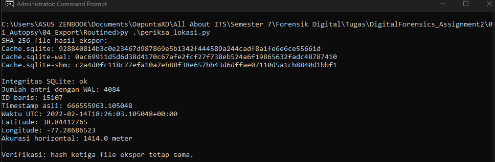

**Mengapa WAL penting:** pembacaan file utama saja menghasilkan 10.720 baris dan keadaan berbeda. Pembacaan bersama WAL menghasilkan 4.084 baris, sesuai tampilan Autopsy. Kesimpulan memakai paket yang konsisten dengan WAL, bukan memilih hasil berdasarkan jumlah baris terbanyak.

**Batas:** tidak adanya artefak pada Geolocation bukan bukti tidak ada data lokasi. Koordinat ini merupakan lokasi terbaru dalam tabel yang diperiksa, dengan ketidakpastian sekitar 1,4 km, bukan posisi presisi bangunan tertentu atau kepastian lokasi terakhir dari semua sumber yang mungkin tersedia.

### 8.3 Waktu reboot terakhir

**Jawaban dari log: 14 Februari 2022, 11:44:13; zona waktu tidak disebutkan pada baris.**

File relevan yang diekspor: `60622-mobile_installation.log.0` dan `60623-mobile_installation.log.1` di `04_Export/Reboot`. Path sumber `mobile_installation.log.0` terkonfirmasi melalui hasil penelusuran:

```text
private/var/installd/Library/Logs/MobileInstallation/mobile_installation.log.0
```

**Proses:** menemukan log instalasi melalui Autopsy, mengekspor log rotasi, mencari literal `Reboot detected`, lalu membandingkan tanggal seluruh hasil. Nama `.0` atau urutan tampilan tidak digunakan sebagai satu-satunya dasar pemilihan terbaru.

Perintah pada folder `04_Export\Reboot`:

```powershell
Select-String -Path '.\60622-mobile_installation.log.0', '.\60623-mobile_installation.log.1' -SimpleMatch 'Reboot detected'
```

Baris terbaru yang ditemukan:

```text
Mon Feb 14 11:44:13 2022 [360] <notice> (0x104538580) main: Reboot detected
```

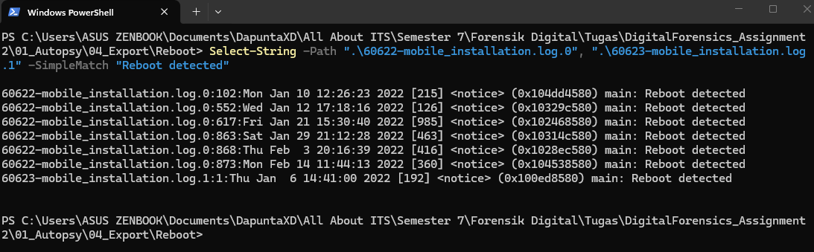

**Metode:** Autopsy untuk provenance dan ekspor; PowerShell untuk pencarian teks. Tidak membutuhkan Python. Output `Select-String` mengikuti urutan file/baris dan **tidak otomatis diurutkan descending**. Waktu terbaru dipilih setelah membandingkan tanggal.

**Batas:** baris menyatakan proses mendeteksi reboot. Dokumen akuisisi juga menyebut boot `2022-02-14 18:24:19 UTC`; nilai itu berbeda dan tidak disamakan secara paksa dengan log. Tanpa rekonsiliasi sumber dan zona waktu, `11:44:13` tidak diberi label UTC/WIB atau diklaim sebagai waktu kernel pasti mulai menyala.

### 8.4 Waktu pembuatan akun Reddit

**Jawaban: 21 Januari 2022, 21:59:38 UTC; username PogProgrammer.**

Sumber:

```text
private/var/mobile/Containers/Shared/AppGroup/C0D4CE88-705C-4BBD-9900-0CC64DAF8243/Library/Application Support/accounts/ivu21eum
```

**Proses:**

1. Pencarian `reddit` mengidentifikasi container aplikasi dan AppGroup.
2. Folder `accounts` memuat `anonymous` dan `ivu21eum`.
3. Keduanya diekspor ke `04_Export/Reddit`. Akun anonim tidak dipakai untuk menjawab waktu akun bernama.
4. File tanpa ekstensi `ivu21eum` ternyata plist dengan struktur **NSKeyedArchiver**. Referensi `UID` menunjuk indeks dalam array `$objects`.
5. Python mengikuti `$top.root` ke objek akun, kemudian `kRedditorKey` ke objek redditor. Field `Username` memberikan `PogProgrammer`.
6. Field `created` mengarah ke `NSDate` dengan `NS.time = 664495178.0`. Nilai ini dihitung dari epoch 2001 UTC, bukan Unix 1970.
7. Nilai `created` akun dan redditor diperiksa dan cocok.

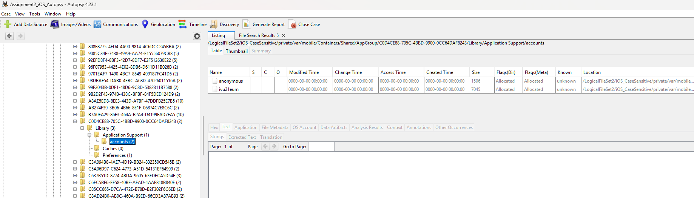

**Kode `04_Export/Reddit/periksa_reddit.py`:**

```python
from pathlib import Path
from datetime import datetime, timedelta, timezone
import hashlib
import plistlib

path = Path(__file__).resolve().parent / "78918-ivu21eum"
before = hashlib.sha256(path.read_bytes()).hexdigest()
archive = plistlib.loads(path.read_bytes())
objects = archive["$objects"]
def resolve(value):
    return objects[value.data] if isinstance(value, plistlib.UID) else value
account = resolve(archive["$top"]["root"])
redditor = resolve(account["kRedditorKey"])
created = resolve(account["created"])["NS.time"]
print("File:", path.name)
print("SHA-256:", before)
print("Username:", resolve(redditor["Username"]))
print("NS.time:", created)
print("Created UTC:", datetime(2001, 1, 1, tzinfo=timezone.utc) + timedelta(seconds=created))
print("Tanggal akun dan redditor sama:", created == resolve(redditor["created"])["NS.time"])
print("Hash file tetap sama:", before == hashlib.sha256(path.read_bytes()).hexdigest())
```

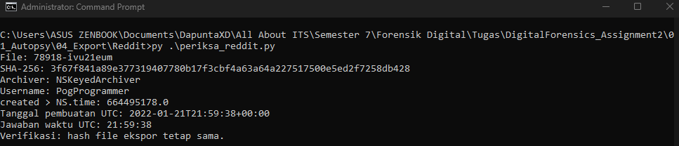

**Keterbatasan Autopsy yang terbukti:** PList viewer mencatat `Can't parse Plist ... com.dd.plist.UID` dan exception ketika menampilkan `ivu21eum`. Ini adalah kesalahan parser/viewer pada struktur tersebut. Python tetap dapat membaca dan mengikuti referensinya; nama file tanpa ekstensi tidak berarti isinya tidak dikenal atau rusak.

### 8.5 Aplikasi yang dihapus

**Jawaban: WeChat, bundle identifier `com.tencent.xin`.**

**Proses:** memakai log instalasi yang sudah diekspor, mencari operasi uninstall, lalu membaca konteks sebelum/sesudahnya. Bundle identifier dikaitkan dengan nama aplikasi dan extension WeChat dalam rangkaian log, bukan berdasarkan tidak ditemukannya folder aplikasi saja.

Pada `04_Export\Reboot`:

```powershell
Select-String -Path '.\60622-mobile_installation.log.0' -SimpleMatch 'Uninstalling identifier com.tencent.xin' -Context 3,10
```

Rangkaian log tanggal **21 Januari 2022 sekitar 17:11:26–17:11:27**, zona waktu belum terverifikasi, memuat permintaan uninstall, `Uninstalling identifier com.tencent.xin`, penghancuran container bundle/data, dan extension `com.tencent.xin.WeChatNotificationServiceExtension`.

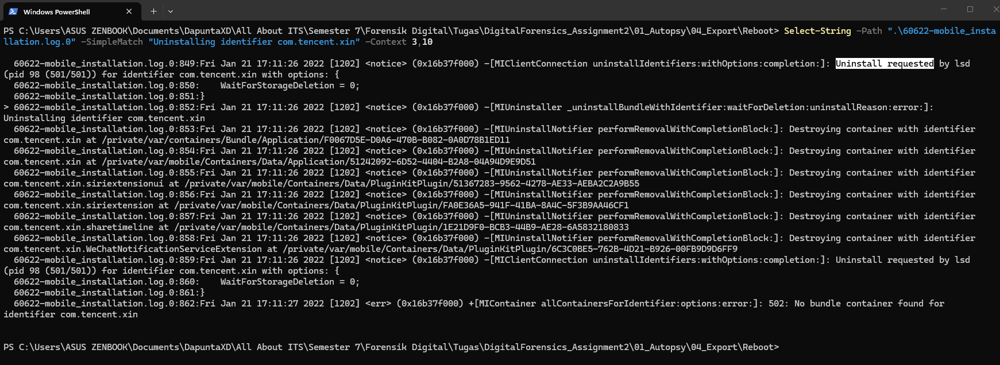

**Metode:** Autopsy + pencarian literal dan korelasi konteks log PowerShell. Tidak ada skrip Python untuk pertanyaan ini. Bukti menunjukkan peristiwa uninstall yang tercatat; tidak digunakan untuk menyimpulkan alasan pengguna menghapus aplikasi.

### 8.6 Notifikasi Reddit terakhir

**Jawaban isi tersimpan:**

> Kornbread and Jorgeous are still Making Fun of Cynthia's Car Crash...

Tiga titik merupakan bagian dari teks yang tersimpan, bukan pemotongan baru dalam README.

**Proses:**

1. Menelusuri `private/var/mobile/Library/UserNotifications/` melalui Autopsy.
2. Nama subfolder berupa UUID sehingga folder Reddit harus dipetakan terlebih dahulu dari `Library.plist`.
3. Dekode NSDictionary NSKeyedArchiver menemukan `com.reddit.Reddit` dipetakan ke **`F6C59A01-8506-44B5-866A-8CB9301E27AA`**.
4. Mengambil `DeliveredNotifications.plist` dari folder UUID tersebut.
5. File dengan nama sama dari folder aplikasi lain pernah diperiksa dan ternyata berisi laporan Screen Time. Kemunculan string Reddit di file itu tidak cukup untuk menyebutnya notifikasi Reddit. File tersebut tidak dipakai sebagai sumber jawaban akhir.
6. File yang benar memuat **22 notifikasi**. Referensi UID pada array dan NSDictionary diselesaikan menggunakan Python.
7. Memilih maksimum `AppNotificationCreationDate.NS.time`, bukan mengambil elemen pertama/terakhir array tanpa memeriksa waktu.

Sumber akhir:

```text
private/var/mobile/Library/UserNotifications/Library.plist
private/var/mobile/Library/UserNotifications/F6C59A01-8506-44B5-866A-8CB9301E27AA/DeliveredNotifications.plist
```

Ekspor akhir ditempatkan di `04_Export/RedditNotifications`. Saat diunggah untuk pemeriksaan, file yang benar pernah memiliki suffix `(1)`; dalam struktur akhir lokal namanya `DeliveredNotifications.plist`. SHA-256 yang membedakannya adalah `2cfee69ca1a5e2366b8bbb4487d5e3320028e0fecc9cbc210dd9e1a76a405531`.

**Kode `04_Export/RedditNotifications/periksa_notifikasi.py`:**

```python
from pathlib import Path
from datetime import datetime, timedelta, timezone
import hashlib
import plistlib

folder = Path(__file__).resolve().parent
paths = [folder / "Library.plist", folder / "DeliveredNotifications.plist"]
before = {p.name: hashlib.sha256(p.read_bytes()).hexdigest() for p in paths}
def open_archive(path):
    archive = plistlib.loads(path.read_bytes())
    objects = archive["$objects"]
    def resolve(value):
        return objects[value.data] if isinstance(value, plistlib.UID) else value
    def dictionary(value):
        value = resolve(value)
        return {resolve(k): resolve(v) for k, v in zip(value["NS.keys"], value["NS.objects"])}
    return resolve(archive["$top"]["root"]), resolve, dictionary
root, resolve, dictionary = open_archive(paths[0])
print("Folder Reddit:", dictionary(root)["com.reddit.Reddit"])
root, resolve, dictionary = open_archive(paths[1])
entries = [dictionary(item) for item in root["NS.objects"]]
latest = max(entries, key=lambda item: item["AppNotificationCreationDate"]["NS.time"])
seconds = latest["AppNotificationCreationDate"]["NS.time"]
print("Jumlah notifikasi:", len(entries))
print("Creation UTC:", datetime(2001, 1, 1, tzinfo=timezone.utc) + timedelta(seconds=seconds))
for field in ("AppNotificationTitle", "AppNotificationMessage", "AppNotificationIdentifier"):
    print(field + ":", latest.get(field))
for path in paths:
    print("SHA-256", path.name, before[path.name])
print("Hash file tetap sama:", before == {p.name: hashlib.sha256(p.read_bytes()).hexdigest() for p in paths})
```

| Field | Nilai |
|---|---|
| Judul | `r/rupaulsdragrace` |
| `AppNotificationCreationDate.NS.time` | `666550798.3817372` |
| Waktu UTC | `2022-02-14 16:59:58.381737` |
| Identifier | `77AC661A-7B6D-4B70-AD3F-C8016D3643C1` |

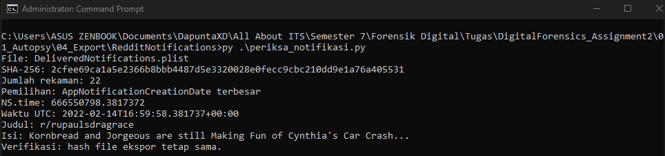

**Metode dan batas:** Autopsy menemukan/mengekspor artefak; Python memetakan folder dan mendekode plist. Waktu adalah nilai field pembuatan notifikasi, bukan pengukuran terpisah waktu paket jaringan diterima. Log Autopsy mencatat kesalahan menampilkan `Library.plist` dan `DeliveredNotifications.plist`, tetapi nama file pada baris log saja tidak membedakan semua salinan yang namanya sama. Atribusi ke UUID sumber akhir memakai provenance ekspor dan hash, bukan nama log semata.

### 8.7 Suara alarm

**Jawaban: Radar (`system:Radar`).**

Sumber:

```text
private/var/mobile/Library/Preferences/com.apple.mobiletimerd.plist
```

**Proses:**

1. File Search dengan nama `com.apple.mobiletimer` menemukan file preferensi terkait jam.
2. `com.apple.mobiletimer.plist` juga diperiksa, tetapi daftar kota world clock bukan jawaban suara alarm atau bukti lokasi terakhir.
3. Pada `com.apple.mobiletimerd.plist`, struktur `MTAlarms → MTAlarms → $MTAlarm` memuat satu alarm.
4. Mengikuti `MTAlarmSound → $MTSound → MTSoundToneID` menghasilkan `system:Radar`.
5. Alarm diberi label **Bed Bath and Beyond Opens**, jam **10:00**, dengan `MTAlarmEnabled = False`.
6. File diekspor dan hasil viewer diperiksa kembali menggunakan Python.

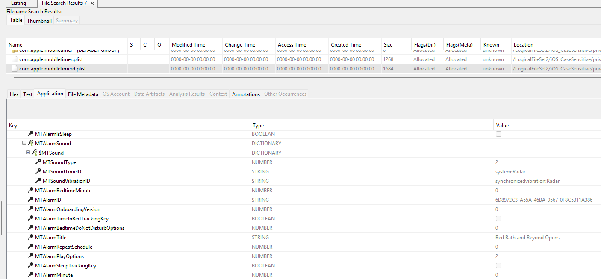

**Kode `04_Export/Alarm/periksa_alarm.py`:**

```python
from pathlib import Path
import hashlib
import plistlib

path = Path(__file__).resolve().parent / "com.apple.mobiletimerd.plist"
before = hashlib.sha256(path.read_bytes()).hexdigest()
plist = plistlib.loads(path.read_bytes())
alarms = plist["MTAlarms"]["MTAlarms"]
print("SHA-256:", before)
print("Jumlah alarm:", len(alarms))
for item in alarms:
    alarm = item["$MTAlarm"]
    print("Judul:", alarm["MTAlarmTitle"])
    print("Jam:", f"{alarm['MTAlarmHour']:02d}:{alarm['MTAlarmMinute']:02d}")
    print("Enabled:", alarm["MTAlarmEnabled"])
    print("Alarm ID:", alarm["MTAlarmID"])
    print("Suara:", alarm["MTAlarmSound"]["$MTSound"]["MTSoundToneID"])
print("Hash file tetap sama:", before == hashlib.sha256(path.read_bytes()).hexdigest())
```

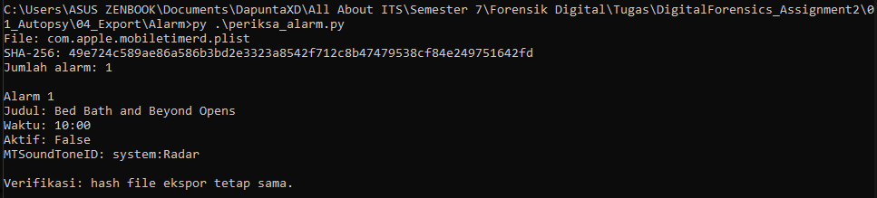

**Interpretasi:** suara tersimpan tetap Radar meskipun alarm sedang tidak aktif. Nilai `system:Default Timer` terdapat pada struktur timer dan tidak digunakan sebagai jawaban alarm. Artefak alarm **berhasil ditampilkan oleh Autopsy**, sehingga penggunaan Python untuk verifikasi tidak menjadi alasan memasukkannya ke daftar gagal parse.

### 8.8 GIF yang dikirim kepada Patrick melalui Bumble

**Jawaban: thirsty steve martin GIF; ID GIPHY `cXCVTR1wUn1a8`.**

Container Bumble yang ditelusuri:

```text
private/var/mobile/Containers/Data/Application/F6664A1F-E4CE-412A-B6F6-825A08EDCC34/
```

**Proses:**

1. File Search untuk Bumble mengarah ke container aplikasi `com.moxco.bumble`.
2. Folder `Documents` dan `Library/Caches` ditelusuri untuk menemukan database relevan.
3. `SharedUserCache.sqlite` diekspor dan diperiksa terlebih dahulu. Tabelnya berisi 12 entri koleksi User; pemeriksaan itu tidak memberikan pesan GIF. Ini merupakan kandidat pencarian, bukan kegagalan parser.
4. Daftar `Library/Caches` menunjukkan **`Chat.sqlite`**, dengan WAL dan SHM. Ketiganya diekspor ke `04_Export/Bumble`.
5. Application viewer membaca tabel `database2`, tetapi kolom `data` menampilkan BLOB.
6. Query menghubungkan `database2.rowid` dengan `secondaryIndex_isReadIndex.rowid` agar arah pesan didapat dari `isIncoming`.
7. BLOB adalah plist NSKeyedArchiver. Python mengikuti UID untuk membaca `self.messageText` dan `self.dateCreated`.
8. Ditemukan satu pesan bertautan GIPHY, `rowid = 19`, ID pesan **`4312590383`**, `isIncoming = 1`.
9. Timestamp Unix `1643942797` dikonversi ke **4 Februari 2022, 02:46:37 UTC**. Epoch Unix digunakan untuk field ini, berbeda dari NSDate pada Reddit.
10. URL pada pesan dibuka di browser untuk mengidentifikasi judul GIF dan mencocokkan ID halaman dengan ID pesan.

Sumber database:

```text
private/var/mobile/Containers/Data/Application/F6664A1F-E4CE-412A-B6F6-825A08EDCC34/Library/Caches/Chat.sqlite
```

**Kode `04_Export/Bumble/periksa_bumble.py`:**

```python
from pathlib import Path
import hashlib
import shutil
import sqlite3
import tempfile
import plistlib
from datetime import datetime, timezone

files = {"73029-Chat.sqlite": "Chat.sqlite",
         "73030-Chat.sqlite-shm": "Chat.sqlite-shm",
         "73031-Chat.sqlite-wal": "Chat.sqlite-wal"}
dbname = "Chat.sqlite"

folder = Path(__file__).resolve().parent

def hashes():
    return {name: hashlib.sha256((folder / name).read_bytes()).hexdigest()
            for name in files}

before = hashes()
print("SHA-256 file hasil ekspor:")
for name, digest in before.items():
    print(name, digest)
with tempfile.TemporaryDirectory() as temp:
    work = Path(temp)
    for source, target in files.items():
        shutil.copy2(folder / source, work / target)
    connection = sqlite3.connect((work / dbname).as_uri() + "?mode=ro", uri=True)
    try:
        print("Integritas SQLite:", connection.execute("PRAGMA integrity_check").fetchone()[0])
        query = """SELECT d.rowid, d.key, d.data, i.isIncoming
                   FROM database2 d JOIN secondaryIndex_isReadIndex i ON i.rowid = d.rowid
                   ORDER BY d.rowid"""
        found = 0
        for rowid, key, data, incoming in connection.execute(query):
            archive = plistlib.loads(data)
            objects = archive["$objects"]
            message = objects[archive["$top"]["root"].data]
            def value(field):
                item = message.get(field)
                return objects[item.data] if isinstance(item, plistlib.UID) else item
            text = value("self.messageText")
            if not isinstance(text, str) or "giphy.com/" not in text:
                continue
            found += 1
            print("Row ID:", rowid, "ID pesan:", key, "isIncoming:", incoming)
            print("Waktu UTC:", datetime.fromtimestamp(value("self.dateCreated"), timezone.utc).isoformat())
            print("Isi pesan:", text)
        print("Jumlah pesan bertautan GIPHY:", found)
    finally:
        connection.close()
print("Hash file ekspor tetap sama:", before == hashes())
```

Hasil inti:

```text
Row ID: 19
ID pesan: 4312590383
isIncoming: 1
Waktu UTC: 2022-02-04T02:46:37+00:00
Isi pesan: https://giphy.com/embed/cXCVTR1wUn1a8
```

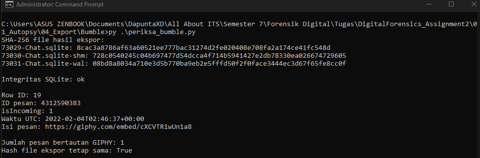

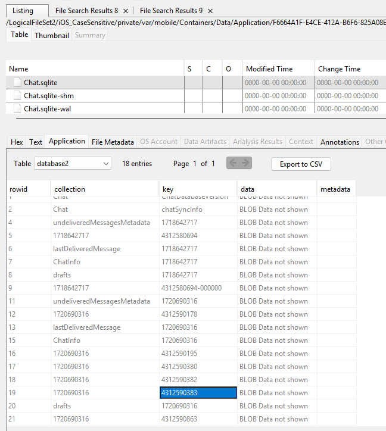

Halaman pembanding: [GIPHY, ID cXCVTR1wUn1a8](https://giphy.com/gifs/80s-movies-three-amigos-john-landis-cXCVTR1wUn1a8). Pada pemeriksaan halaman, judul yang terbaca adalah **thirsty steve martin GIF**.

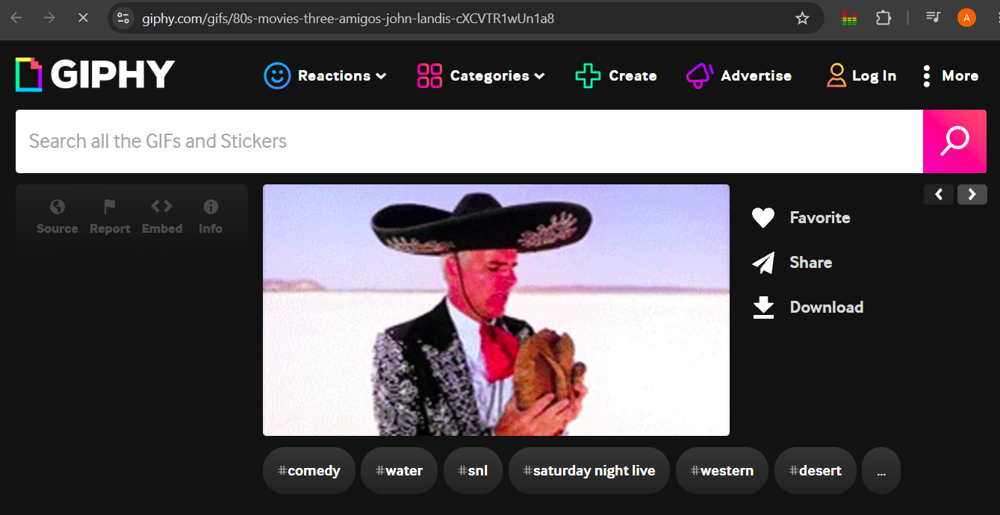

**Batas bukti judul:** screenshot `36` menampilkan visual dan URL tetapi tidak menampilkan judul teks secara utuh. Screenshot awal halaman yang turut diperiksa memperlihatkan judul pada tab/halaman, namun belum tercantum dengan nama terpisah dalam inventaris repository terakhir. Karena itu, screenshot `36` tidak diklaim sendirian membuktikan ejaan judul. Bukti primer perangkat adalah URL dan ID GIF; nama diperoleh melalui verifikasi eksternal saat pemeriksaan.

**Keterbatasan Autopsy:** SQLite viewer membaca struktur dan 18 entri `database2`, tetapi tidak menyajikan BLOB sebagai pesan percakapan. Kondisi ini dibedakan dari error membaca file SQLite. `isIncoming = 1` mendukung arah pesan diterima oleh akun pada perangkat; identitas pengirim tidak ditebak dari nama GIF.

## 9. Artefak dan operasi yang tidak berhasil diproses

### 9.1 Klasifikasi temuan

| Artefak/operasi | Gejala teramati | Klasifikasi dan tindak lanjut |
|---|---|---|
| ZIP internal pada LogicalFileSet1 | `SevenZipException`, `ArrayIndexOutOfBoundsException`, `DATAERROR` | Kegagalan ekstraksi arsip pada percobaan pertama; diekstrak manual dan ditambahkan ulang sebagai LogicalFileSet2 |
| iOS Analyzer pada sumber pertama | `data source does not appear to be iOS, skipping` | Modul dilewati; bukan hasil parsing iOS dan bukan bukti bahwa dataset tidak berisi iOS |
| Notes: `ZICNOTEDATA.ZDATA` | `BLOB Data not shown` | Keterbatasan tampilan/dekode payload; GZIP dan teks diolah dengan Python |
| Bumble: `Chat.sqlite`, `database2.data` | `BLOB Data not shown` pada pesan `4312590383` | Struktur SQLite terbaca, payload percakapan belum disajikan; NSKeyedArchiver didekode dengan Python |
| Reddit: `ivu21eum` dan `anonymous` | PListViewer gagal membaca root bertipe UID dan melempar exception | Error parser/viewer plist; file akun bernama didekode dengan Python |
| `Library.plist` dan `DeliveredNotifications.plist` | Error PListViewer pada UID | Kegagalan tampilan plist yang tercatat; salinan final ditentukan dari folder dan hash |
| `AddressBook.sqlitedb`, ID Autopsy `79063` | Tabel `ABPersonFullTextSearch` gagal dibaca oleh SqliteTextExtractor | Kegagalan ekstraksi teks tabel tertentu; tidak menyimpulkan seluruh database rusak |
| `entities.db`, ID `84754` | Tabel `entity_fts` gagal dibaca | Kegagalan ekstraksi teks tabel tertentu |
| `email_footer.html`, ID `13086` | `Error chunking content`, `Failed to search file`, `XML parse error` | Kegagalan pemrosesan teks/pencarian pada berkas HTML; konteks file sumber belum dipetakan lengkap |
| `2F36DAFFE19D35639048C279892DCE37`, ID `60450` | Keyword Search mengalami `StackOverflowError` | Kegagalan analisis keyword pada file tertentu; format dan path asal belum dipastikan |
| File `signature`, `.strings`, dan file bernama numerik lain dalam log | Peringatan Tika meminta pemeriksaan log lebih rinci | Dicatat sebagai peringatan tambahan; tidak diberi penyebab final tanpa log Tika |

Jalur lengkap Notes, Reddit, notifikasi, alarm, lokasi, dan Bumble dicantumkan pada bagian analisis. Untuk `AddressBook.sqlitedb`, `entities.db`, `email_footer.html`, dan file bernama hash, log yang diperiksa memberikan **nama dan ID**, bukan seluruh path asal. Penelusuran provenance berdasarkan ID masih diperlukan bila tabel laporan akhir mengharuskan lokasi lengkap; path tidak direkonstruksi dari dugaan.

### 9.2 Bukti kesalahan PList viewer

Cuplikan `autopsy.log.0`:

```text
2026-10-26 12:04:37.034 ... PListViewer parseProperty
SEVERE: Can't parse Plist for key = root value of type class com.dd.plist.UID
2026-10-26 12:04:37.067 ... PListViewer$2 done
SEVERE: Exception while parsing/dislaying  plist file ivu21eum
java.util.concurrent.ExecutionException: java.lang.NullPointerException ...
```

Ada kejadian lain untuk nama file sama pada 12:08:24. Screenshot menggunakan kejadian pertama. Ejaan `dislaying` dipertahankan sebagaimana log. Ini adalah waktu aktivitas viewer setelah ingest, bukan waktu kejadian pada ponsel.

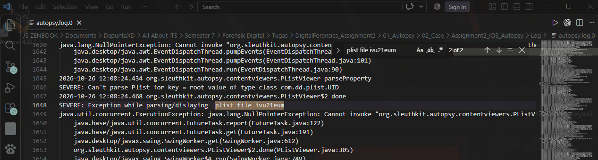

### 9.3 Bukti kegagalan ekstraksi teks tabel SQLite

Cuplikan `autopsy.log.0`:

```text
2026-10-25 22:37:38.707 ... SqliteTextExtractor$SQLiteStreamReader read
WARNING: Error attempting to read file table: [ABPersonFullTextSearch] for file: [AddressBook.sqlitedb] (id=79063).
2026-10-25 22:39:18.621 ... SqliteTextExtractor$SQLiteStreamReader read
WARNING: Error attempting to read file table: [entity_fts] for file: [entities.db] (id=84754).
```

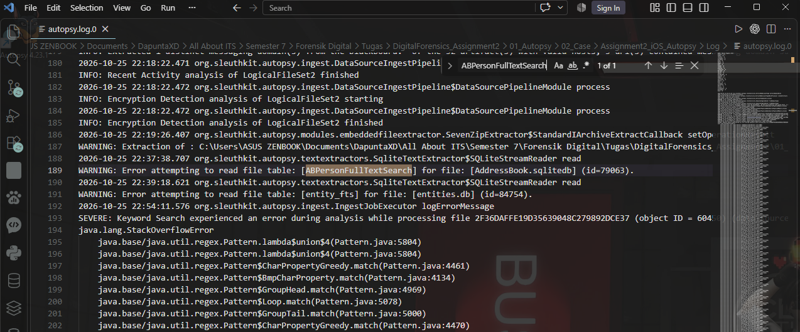

Nama kelas menunjukkan operasi ekstraksi teks. Peringatan tidak menyebut penyebab final, sehingga tidak langsung diatribusikan ke enkripsi, korupsi SQLite, atau ketidaktersediaan plugin tertentu.

### 9.4 Memeriksa log secara reproduktif

Log yang diperiksa bernama `autopsy.log.0`, `autopsy.log.1`, dan `autopsy.log.2`. Folder pada screenshot adalah **`Log`** di bawah kasus; nama folder aktual menjadi acuan, bukan asumsi bahwa selalu bernama `Logs`.

Contoh pencarian dari folder log, tanpa memodifikasi file:

```powershell
Select-String -Path '.\autopsy.log.0', '.\autopsy.log.1', '.\autopsy.log.2' -SimpleMatch -Pattern 'Error attempting to read file table', 'Can''t parse Plist', 'Exception while parsing/dislaying', 'Error unpacking file', 'StackOverflowError', 'XML parse error', 'skipping' -Context 1,2
```

Nomor `.0`, `.1`, dan `.2` merupakan log yang dapat berotasi, bukan nomor tahap investigasi yang selalu tetap. Pada salinan yang ditinjau, `.2` merekam percobaan awal; `.0` berisi ingest kedua dan aktivitas viewer berikutnya. Catatan didasarkan pada timestamp dan isi, bukan suffix saja.

**Yang tidak dimasukkan sebagai kegagalan parsing:** tidak ada hasil pada Geolocation, tidak ditemukannya GIF dalam SharedUserCache, alarm yang berhasil tampil, dan tidak ditemukannya file Chrome pada sumber tertentu. Semua itu perlu dibedakan dari exception yang eksplisit.

## 10. Integritas file dan penyimpanan Git

Dokumentasi, kode, dan ekspor terpilih ditempatkan dalam repository. Arsip mentah, ekstraksi penuh, dan database kasus tetap berada di penyimpanan lokal dan dikecualikan dari Git.

Isi `.gitignore` pada akar `DigitalForensics_Assignment2`:

```gitignore
/01_Autopsy/00_Raw/
/01_Autopsy/01_Extracted/
/01_Autopsy/02_Case/
```

Git tidak menyimpan folder kosong sehingga tiga direktori itu mungkin tidak terlihat pada clone repository. Tidak adanya folder tersebut di GitHub bukan bukti bahwa dataset tidak pernah diproses.

Isi `.gitattributes` untuk mempertahankan byte, termasuk line ending log:

```gitattributes
* -text
```

Pengaturan ini menonaktifkan konversi teks otomatis Git. Verifikasi hash tetap dilakukan; aturan Git bukan pengganti pemeriksaan integritas sumber. Keluaran `Tee-Object`, CSV, screenshot, dan README adalah dokumentasi turunan, bukan pengganti artefak sumber.

## 11. Indeks dokumentasi dan batas kesimpulan

### 11.1 Bukti yang dirujuk

| Kelompok | Screenshot |
|---|---|
| Integritas dan ekstraksi | `01`, `02`, `03`, `04`, `05` |
| Kasus dan konfigurasi ingest | `06`, `08`, `09` |
| Ingest awal dan error | `10`, `11`, `12`, `13`, `14`, `15` |
| Konflik kapitalisasi dan ekstraksi ulang | `16`, `17`, `18`, `19` |
| Ingest kedua | `23` |
| Notes | `24`, `25` |
| Lokasi | `26`, `27`, `28` |
| Reboot | `29` |
| Reddit account | `30`, `31` |
| Uninstall WeChat | `32` |
| Reddit notification | `33` |
| Alarm | `34`, `35` |
| Bumble | `36`, `37`, `38` |
| Parser/viewer errors | `39`, `40` |

### 11.2 Hash artefak utama

| File ekspor | SHA-256 |
|---|---|
| `78909-NoteStore.sqlite` | `e6cfa93c58d0d2f8afbae1d96d20d96b4da3fc5aaafbcfad2f71a9bddf12862d` |
| `Cache.sqlite` | `928840814b3c0e23467d987869e5b1342f444589a244cadf8a1fe6e6ce55661d` |
| `78918-ivu21eum` | `3f67f841a89e377319407780b17f3cbf4a63a64a227517500e5ed2f7258db428` |
| `DeliveredNotifications.plist` milik Reddit | `2cfee69ca1a5e2366b8bbb4487d5e3320028e0fecc9cbc210dd9e1a76a405531` |
| `com.apple.mobiletimerd.plist` | `49e724c589ae86a586b3bd2e3323a8542f712c8b47479538cf84e249751642fd` |
| `73029-Chat.sqlite` | `8cac3a8786af63a60521ee777bac31274d2fe020408e708fa2a174ce41fc548d` |

Hash WAL/SHM ikut dihitung oleh skrip dan terlihat pada keluaran pemeriksaan. Nilai hash membuktikan kesamaan byte dengan salinan yang diperiksa, bukan menilai kredibilitas semantik setiap field.

### 11.3 Status pekerjaan

Delapan pertanyaan telah dianalisis dengan batas interpretasi yang dijelaskan. Bukti tampilan BLOB serta error PListViewer dan SQLite text extractor sudah dikumpulkan. Kesalahan tidak digeneralisasi menjadi kegagalan semua fitur Autopsy.

## 12. Referensi teknis

- [Autopsy: Data Sources](https://sleuthkit.org/autopsy/docs/user-docs/4.23.0/ds_page.html)
- [Autopsy: Ingest Modules](https://sleuthkit.org/autopsy/docs/user-docs/4.23.0/ingest_page.html)
- [Autopsy: Embedded File Extractor](https://sleuthkit.org/autopsy/docs/user-docs/4.23.0/embedded_file_extractor_page.html)
- [Autopsy: File Type Identification](https://www.sleuthkit.org/autopsy/docs/user-docs/4.23.0/file_type_identification_page.html)
- [Autopsy: iOS Analyzer integration](https://sleuthkit.org/autopsy/docs/user-docs/4.23.0/ileapp_page.html)
- [Microsoft: case sensitivity pada direktori Windows](https://learn.microsoft.com/en-us/windows/wsl/case-sensitivity)
- [Python: plistlib](https://docs.python.org/3/library/plistlib.html)
- [Python: sqlite3](https://docs.python.org/3/library/sqlite3.html)
- [SQLite: Write-Ahead Logging](https://www.sqlite.org/wal.html)