# Investigasi iOS Full File System menggunakan Log2Timeline / Plaso

Pemeriksaan menggunakan Log2Timeline/Plaso dalam Docker Desktop pada Windows, PowerShell, dan Python 3. Plaso digunakan untuk mengekstraksi event, menghasilkan timeline, menelusuri aktivitas, serta mencatat warning pemrosesan. Pemeriksaan manual terhadap file sumber dilakukan ketika hasil timeline belum menyediakan informasi yang dibutuhkan.

## Daftar isi

1. [Tujuan dan ringkasan hasil](#1-tujuan-dan-ringkasan-hasil)
2. [Dataset, provenance, dan folder](#2-dataset-provenance-dan-folder)
3. [Persiapan lingkungan](#3-persiapan-lingkungan)
4. [Ekstraksi dan ekspor timeline](#4-ekstraksi-dan-ekspor-timeline)
5. [Inventaris dan masalah pinfo](#5-inventaris-dan-masalah-pinfo)
6. [Penelusuran CSV tanpa duplikasi](#6-penelusuran-csv-tanpa-duplikasi)
7. [Kode pendamping pemeriksaan manual](#7-kode-pendamping-pemeriksaan-manual)
8. [Analisis delapan pertanyaan](#8-analisis-delapan-pertanyaan)
9. [Warning dan error ekstraksi](#9-warning-dan-error-ekstraksi)
10. [Integritas, keterbatasan, dan status hasil](#10-integritas-keterbatasan-dan-status-hasil)
11. [Indeks dokumentasi](#11-indeks-dokumentasi)
12. [Referensi](#12-referensi)

## 1. Tujuan dan ringkasan hasil

Bagian tugas Plaso mencakup pemrosesan dataset dengan `log2timeline`, ekspor CSV menggunakan `psort`, serta identifikasi artefak atau event yang tidak dapat diparse. Delapan pertanyaan kasus digunakan sebagai sasaran pencarian bukti. Jawaban tidak ditetapkan dari nama parser atau hasil pencarian kata kunci saja; isi record dan konteks sumber diperiksa sebelum penarikan kesimpulan.

| No. | Pertanyaan | Temuan | Dasar dan metode |
|---|---|---|---|
| 1 | Jumlah barang pada daftar belanja Patrick | **4**: Energy drinks, Bread, Hand soap, Birthday card | Plaso menemukan catatan; SQL dan dekompresi manual mengungkap teks tambahan |
| 2 | Lokasi terakhir ponsel | **38.84412765, -77.28686523**, record 14 Februari 2022, 18:26:03.105048 UTC | Pemeriksaan manual tabel lokasi `Cache.sqlite`; terbaru pada tabel yang diperiksa |
| 3 | Reboot terakhir yang teridentifikasi | **14 Februari 2022, 18:24:19.433593 UTC** | Marker `system boot` pada event `unified_logging` hasil Plaso |
| 4 | Pembuatan akun Reddit | **21 Januari 2022, 21:59:38 UTC**, username **PogProgrammer** | Penelusuran container diikuti decoding NSKeyedArchiver manual |
| 5 | Aplikasi yang dihapus | **WeChat**, bundle ID `com.tencent.xin` | Event uninstall hasil Plaso dan konteks log sumber |
| 6 | Isi notifikasi Reddit terakhir yang tersimpan | **Kornbread and Jorgeous are still Making Fun of Cynthia's Car Crash...** | Pemetaan aplikasi dan decoding plist manual; timestamp pembuatan maksimum |
| 7 | Suara alarm yang dipilih | **Radar**, nilai `system:Radar` | Plaso menemukan path preferensi; pembacaan plist manual |
| 8 | Nama GIF yang diterima melalui Bumble | **thirsty steve martin GIF**, ID `cXCVTR1wUn1a8` | Decoding pesan masuk SQLite/BLOB manual dan pencocokan halaman GIPHY |

**Batas penting:** estimasi akurasi horizontal record lokasi adalah **1414 meter, sekitar 1,4 km**. Record terbaru pada tabel tersebut belum membuktikan lokasi paling akhir dari semua sumber dalam dataset. Waktu notifikasi adalah field pembuatan notifikasi tersimpan. Judul GIF berasal dari halaman eksternal saat pemeriksaan, sedangkan bukti lokal menyimpan URL. Timeline selesai dihasilkan, tetapi 54 baris error pengelolaan task menyebabkan kelengkapan seluruh hasil tidak dapat dipastikan.

## 2. Dataset, provenance, dan folder

Sumber: [Digital Corpora, 2022 CTF - iOS Full File System.zip](https://digitalcorpora.s3.amazonaws.com/corpora/scenarios/magnet/2022%20CTF%20-%20iOS%20Full%20File%20System.zip).

Dataset yang digunakan sama dengan pemeriksaan Autopsy. Sumber pemrosesan Plaso adalah folder Full File System hasil ekstraksi, bukan database kasus atau hasil ingest Autopsy. Autopsy dan Plaso membaca dataset yang sama. Pemakaian folder sumber yang sebelumnya juga dibuka dengan Autopsy tidak menjadikan query Python sebagai hasil parsing Autopsy.

| Lokasi | Fungsi |
|---|---|
| `../01_Autopsy/00_Raw/` | Arsip unduhan asli |
| `../01_Autopsy/01_Extracted/` | Ekstraksi arsip dan berkas pendamping |
| `C:\DF_A2\iOS_CaseSensitive` | Folder sumber iOS untuk pemeriksaan ini; berisi direktori `private` |
| `01_Hasil/` | Storage `.plaso` dan ekspor CSV |
| `02_Log/` | Log ekstraksi, exit code, warning, dan file percobaan |
| `03_Dokumentasi/` | Metadata image, versi, inventaris, ringkasan warning |
| `03_Dokumentasi/Screenshots/` | Screenshot 01 sampai 31 |
| `04_Laporan/` | Tempat laporan akhir; keberadaan folder tidak membuktikan laporan sudah dibuat |

```text
03_Log2Timeline/
  01_Hasil/
    01_iOS_Timeline.plaso
    03_iOS_Timeline.csv
  02_Log/
    01_Extraction_ExitCode.txt
    01_Log2Timeline.log
    02_Parsing_Warnings.txt
    02_Parsing_Warnings_Details.txt
    05_Notes_Events.csv
    Worker_00_01_Log2Timeline.log
    Worker_01_01_Log2Timeline.log
    Worker_02_01_Log2Timeline.log
    Worker_03_01_Log2Timeline.log
  03_Dokumentasi/
    00_Docker_Image.json
    00_Plaso_Version.txt
    04_Plaso_Inventory.txt
    05_Parsing_Warnings_Summary.txt
    Screenshots/
  04_Laporan/
  README.md
```

Struktur mengacu pada `struktur_folder.txt` dari root tugas. `05_Notes_Events.csv` terlihat 0 KB pada inventaris yang diperiksa dan tidak digunakan sebagai dasar temuan. Empat worker log terlihat 0 byte dan dipertahankan sebagai jejak pelaksanaan. Hasil pemeriksaan utama berasal dari storage, CSV lengkap, log utama, dan artefak sumber.

## 3. Persiapan lingkungan

### 3.1 Variabel lokasi

Semua contoh PowerShell berikut mengasumsikan sesi berada di folder utama `03_Log2Timeline`. Path hasil menyesuaikan organisasi akhir. Pada saat ekstraksi awal, file hasil masih berada langsung pada folder utama; reorganisasi dilakukan setelah proses selesai.

```powershell
$CasePath = 'C:\Users\ASUS ZENBOOK\Documents\DapuntaXD\All About ITS\Semester 7\Forensik Digital\Tugas\DigitalForensics_Assignment2\03_Log2Timeline'
$EvidencePath = 'C:\DF_A2\iOS_CaseSensitive'
$ResultPath = Join-Path $CasePath '01_Hasil'
$LogPath = Join-Path $CasePath '02_Log'
$DocPath = Join-Path $CasePath '03_Dokumentasi'
Set-Location -LiteralPath $CasePath
```

### 3.2 WSL, Docker Desktop, dan sumber data

```powershell
wsl --status
docker --version
docker info
Test-Path -LiteralPath $EvidencePath
Get-ChildItem -LiteralPath $EvidencePath | Select-Object Mode, Name
python --version
```

Pemeriksaan awal menunjukkan WSL versi default 2 dengan distribusi default `docker-desktop`. Docker CLI terpasang, tetapi server sempat gagal diakses melalui pipe `dockerDesktopLinuxEngine`. Setelah Docker Desktop berjalan, `docker info` berhasil menampilkan bagian Server dengan engine Linux. Instalasi CLI saja belum cukup untuk menjalankan container.

Informasi yang diamati: Docker 29.6.1, arsitektur engine x86_64, memori sekitar 15,42 GiB, dan 20 CPU yang terlihat oleh engine. Python host menggunakan versi 3.10; traceback container memperlihatkan Python 3.14. Versi host dan container merupakan lingkungan berbeda.

### 3.3 Metadata tool

Image yang digunakan adalah `log2timeline/plaso`. Versi Plaso yang didokumentasikan adalah **20260720**. Format storage `20260516` yang ditampilkan `pinfo` adalah versi format storage, bukan nomor rilis tool.

Contoh pencatatan metadata pada pelaksanaan baru:

```powershell
docker image inspect log2timeline/plaso |
    Out-File -FilePath (Join-Path $DocPath '00_Docker_Image.json') -Encoding utf8
docker run --rm log2timeline/plaso log2timeline --version |
    Out-File -FilePath (Join-Path $DocPath '00_Plaso_Version.txt') -Encoding utf8
```

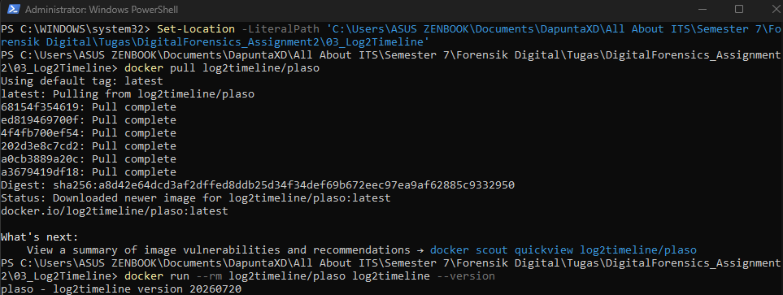

## 4. Ekstraksi dan ekspor timeline

### 4.1 Peran tiga tool

- `log2timeline`: membaca sumber, menjalankan parser, dan menyimpan event beserta metadata ke `.plaso`.
- `psort`: membaca storage `.plaso` untuk menghasilkan keluaran yang dapat dianalisis, dalam pekerjaan ini CSV `dynamic`.
- `pinfo`: menampilkan informasi storage, sesi, event, dan warning. `pinfo` tidak menggantikan ekspor CSV.

CSV dibuat untuk memenuhi perintah tugas dan menjadi acuan penelusuran hasil parsing. Jawaban yang memerlukan decoding manual tetap diberi atribusi manual; keberadaan file CSV tidak membuat semua jawaban menjadi hasil murni Plaso.

### 4.2 Ekstraksi seluruh direktori sumber

```powershell
# Hanya untuk pelaksanaan baru dengan target storage yang belum ada.
$StorageFile = Join-Path $ResultPath '01_iOS_Timeline.plaso'
if (Test-Path -LiteralPath $StorageFile) { throw 'Storage sudah ada; jangan ekstraksi ulang.' }
docker run --rm --name df-a2-extraction `
    --mount "type=bind,source=$EvidencePath,target=/evidence,readonly" `
    --mount "type=bind,source=$ResultPath,target=/output" `
    --mount "type=bind,source=$LogPath,target=/logs" `
    log2timeline/plaso log2timeline `
    --logfile /logs/01_Log2Timeline.log `
    --storage-file /output/01_iOS_Timeline.plaso /evidence
$ExtractionExitCode = $LASTEXITCODE
$ExtractionExitCode | Out-File (Join-Path $LogPath '01_Extraction_ExitCode.txt')
```

Sumber dipasang read-only pada `/evidence`. Folder hasil dan log terpisah dari sumber. Karena input merupakan direktori hasil ekstraksi, cakupan “seluruh dataset” berarti seluruh pohon file yang diberikan kepada tool, dengan keterbatasan format, parser, dan error pelaksanaan. Ini bukan pemeriksaan sektor kosong atau seluruh media fisik iPhone.

Hasil terdokumentasi: **16.024.624 event** dan **9.655 extraction warning**. Durasi ekstraksi sekitar **5 jam 2 menit 29 detik**. Status selesai membuktikan proses mencapai tahap akhir, bukan bahwa seluruh file berhasil diparse.

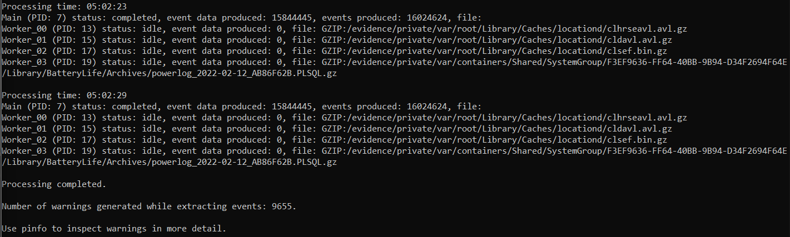

### 4.3 Ekspor CSV menggunakan psort

Storage dan CSV masing-masing berukuran sekitar 11 GB. CSV adalah hasil turunan yang diperlukan tugas, bukan salinan identik storage. Tidak perlu membuat ekspor penuh tambahan hanya untuk menyaring sebuah pertanyaan.

```powershell
# Dokumentasi reproduksi. CSV pada kasus ini sudah tersedia.
$CsvFile = Join-Path $ResultPath '03_iOS_Timeline.csv'
if (Test-Path -LiteralPath $CsvFile) { throw 'CSV sudah ada; gunakan hasil yang tersedia.' }
docker run --rm --name df-a2-psort `
    --mount "type=bind,source=$ResultPath,target=/output" `
    log2timeline/plaso psort `
    -o dynamic -w /output/03_iOS_Timeline.csv `
    /output/01_iOS_Timeline.plaso
$PsortExitCode = $LASTEXITCODE
"psort exit code: $PsortExitCode"
```

Durasi ekspor yang didokumentasikan sekitar **1 jam 4 menit 58 detik**. Perintah `-o dynamic` mengatur format output; `-w` menunjukkan lokasi file CSV. File `.plaso` tetap menjadi storage asal.

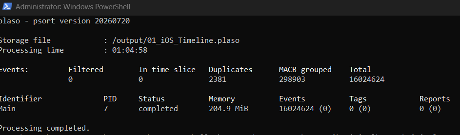

### 4.4 Pembatalan psort yang sempat berjalan

Percobaan ekspor pernah dihentikan dengan Ctrl+C, tetapi container masih terlihat aktif. Status sebenarnya diperiksa melalui Docker:

```powershell
docker ps --no-trunc --format "table {{.ID}}\t{{.Image}}\t{{.Command}}\t{{.Status}}"
```

Container yang teridentifikasi menjalankan `psort` saat itu memiliki ID awal `b33e19bfb682`. Untuk container bernama pada contoh reproduksi:

```powershell
docker stop --timeout 30 df-a2-psort
docker ps --format "table {{.ID}}\t{{.Names}}\t{{.Status}}"
```

`--time` sempat menghasilkan peringatan deprecated; gunakan `--timeout`. Jika penghentian normal gagal dan container yang tepat masih aktif, `docker kill df-a2-psort` menghentikannya secara paksa. Perintah tersebut hanya ditujukan pada container ekspor yang telah diverifikasi, bukan semua container.

## 5. Inventaris dan masalah pinfo

### 5.1 Informasi sesi dan event

```powershell
docker run --rm `
    --mount "type=bind,source=$ResultPath,target=/output,readonly" `
    log2timeline/plaso pinfo --sections sessions,events `
    /output/01_iOS_Timeline.plaso
```

Inventaris yang sudah disimpan berada di [04_Plaso_Inventory.txt](./03_Dokumentasi/04_Plaso_Inventory.txt). Daftar parser/event digunakan untuk memilih sumber yang benar-benar muncul pada hasil, bukan untuk mengasumsikan bahwa semua aplikasi mendapat parser khusus.

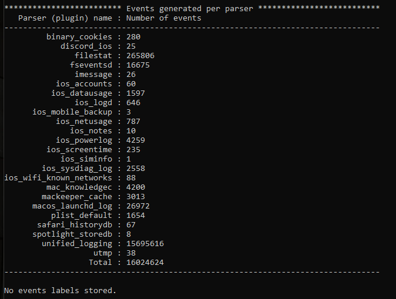

### 5.2 Kegagalan ringkasan warning

Perintah awal `pinfo --sections warnings` mengalami traceback:

```text
TypeError: '<' not supported between instances of 'WarningCount' and 'WarningCount'
```

Traceback mengarah ke `Counter.most_common(10)` saat membandingkan objek `WarningCount` untuk tabel peringkat warning. Exit code yang diamati adalah **1**. Ini merupakan kegagalan pelaporan warning pada lingkungan tersebut; bukan bukti mandiri bahwa seluruh storage rusak.

Workaround sesi menonaktifkan pencetakan tabel counter yang bermasalah agar detail warning tetap dapat dikeluarkan. Bentuk reproduksi runtime di bawah tidak mengubah file paket di image:

```powershell
# Contoh reproduksi workaround, bukan perintah yang perlu diulang.
$PinfoFix = @'
import sys
from plaso.cli import pinfo_tool
from plaso.scripts import pinfo
pinfo_tool.PinfoTool._PrintWarningCountersTable = lambda *args, **kwargs: None
sys.argv = ["pinfo", "--sections", "warnings", "/output/01_iOS_Timeline.plaso"]
sys.exit(pinfo.Main())
'@
docker run --rm --entrypoint python3 `
    --mount "type=bind,source=$ResultPath,target=/output,readonly" `
    log2timeline/plaso -c $PinfoFix
```

Detail warning tersedia di [02_Parsing_Warnings_Details.txt](./02_Log/02_Parsing_Warnings_Details.txt), sekitar 4,48 MB. File tersebut memuat 9.655 blok warning dengan identifier unik. Pengambilan detail juga pernah menghasilkan exit code 1; penyebab akhir tidak dapat dipastikan dari stdout yang tersedia karena stderr akhir belum terekam pada file tersebut. Keberadaan detail tidak boleh dilaporkan sebagai keberhasilan penuh perintah `pinfo`.

## 6. Penelusuran CSV tanpa duplikasi

### 6.1 Prinsip pencarian

Alur pencarian dimulai dari konsep pertanyaan, kemudian dikelompokkan menurut parser dan path sumber. Contohnya `uninstall` mengungkap bundle identifier dari isi log; identifier tersebut tidak diasumsikan sebelum pencarian. Pada pesan unified logging, pencarian dibedakan antara metadata dan bagian `Event message:`.

Pencarian kata `location`, `alarm`, atau `notification` sering menemukan nama resource, preferensi, atau aktivitas service. Kemunculan kata tidak langsung membuktikan koordinat perangkat, suara alarm, atau isi notifikasi. Sampel dibatasi untuk menjaga keluaran tetap terbaca, sedangkan jumlah kecocokan dihitung sepanjang pemindaian.

### 6.2 Error NUL pada Python host

Pemindaian awal menggunakan `csv.DictReader` pada Python 3.10 berhenti dengan `_csv.Error: line contains NUL`. Penyesuaian berikut mengganti NUL dengan teks literal `\x00` hanya dalam stream pembacaan. CSV sumber tidak ditulis ulang. Pada pemindaian lengkap terhitung **93 karakter NUL**.

Ini merupakan masalah pembacaan output oleh skrip host. NUL pada CSV bukan dengan sendirinya bukti bahwa parser Plaso gagal membaca file sumber. Normalisasi menghasilkan representasi baca yang harus dijelaskan, bukan diklaim identik byte demi byte dengan teks mentah.

### 6.3 Skrip pencarian yang dapat digunakan ulang

Kode berikut disusun ulang untuk reproduksi dengan path akhir. Simpan sebagai `telusuri_csv.py` di folder utama bila akan menjalankan pemeriksaan ulang. Nama skrip ini bukan klaim bahwa file tersebut sudah ada pada struktur folder historis. Skrip membaca CSV secara streaming dan tidak membuat CSV baru. Setiap pemanggilan memindai file besar lagi; jalankan hanya pencarian yang diperlukan.

```python
import argparse, csv, re
from collections import Counter, defaultdict
from datetime import datetime
from pathlib import Path

p = argparse.ArgumentParser()
p.add_argument('mode', choices=['notes', 'location', 'coordinates', 'private',
    'boot', 'sessions', 'lastboot', 'reddit', 'uninstall', 'notification', 'alarm', 'bumble'])
p.add_argument('--csv', default='01_Hasil/03_iOS_Timeline.csv')
a = p.parse_args()
csv.field_size_limit(2147483647)
counts, samples, sessions = Counter(), defaultdict(list), {}
nul = 0

def readable_lines(stream):
    global nul
    for line in stream:
        nul += line.count('\x00')
        yield line.replace('\x00', r'\x00')

def actual_message(row):
    message = row.get('message', '')
    return message.partition('Event message:')[2].strip() if row.get('parser') == 'unified_logging' else message

def dt(row):
    try:
        return datetime.fromisoformat(row.get('datetime', ''))
    except ValueError:
        return None

patterns = {
    'location': r'latitude|longitude|location|gps|coordinates',
    'coordinates': r'latitude|longitude|coordinates|\blat\b|\blon\b',
    'boot': r'\b(?:reboot\w*|restart\w*|boot\w*)\b',
    'uninstall': r'uninstall',
    'alarm': r'alarm'
}
print('Source:', Path(a.csv).resolve())
print('Mode:', a.mode)
print(r'Reading adjustment: NUL represented as literal \x00; source unchanged')
with Path(a.csv).open('r', encoding='utf-8-sig', newline='') as stream:
    reader = csv.DictReader(readable_lines(stream))
    required = {'parser', 'message', 'datetime', 'display_name'}
    if not required.issubset(reader.fieldnames or []):
        raise RuntimeError(f'Unexpected CSV columns: {reader.fieldnames}')
    for row in reader:
        if None in row or any(row.get(k) is None for k in required):
            raise RuntimeError(f'Malformed CSV record near physical line {reader.line_num}')
        parser, msg = row['parser'], actual_message(row)
        if a.mode in ('sessions', 'lastboot'):
            if parser != 'unified_logging':
                continue
            found = re.search(r'Boot Identifier:\s*([0-9A-Fa-f-]{36})', row['message'])
            timestamp = dt(row)
            if not found or timestamp is None:
                continue
            boot = found.group(1).upper()
            if a.mode == 'lastboot' and '=== system boot:' not in msg:
                continue
            item = sessions.setdefault(boot, {'first': timestamp, 'last': timestamp,
                'count': 0, 'source': row['display_name'], 'message': msg})
            item['count'] += 1
            if timestamp < item['first']:
                item.update(first=timestamp, source=row['display_name'], message=msg)
            item['last'] = max(item['last'], timestamp)
            continue
        if a.mode == 'notes':
            hit = 'ios_notes' in parser
        elif a.mode == 'reddit':
            hit = 'reddit' in (msg + ' ' + row['display_name']).lower()
        elif a.mode == 'notification':
            hit = 'reddit' in msg.lower() and re.search(r'notification|push|bulletin', msg, re.I)
        elif a.mode == 'bumble':
            hit = 'bumble' in (msg + ' ' + row['display_name']).lower()
        elif a.mode == 'private':
            hit = parser == 'unified_logging' and 'Process image path: /usr/libexec/locationd ' in row['message'] and '<private>' in msg
        else:
            hit = re.search(patterns[a.mode], msg, re.I)
            if a.mode == 'coordinates':
                hit = hit and parser == 'unified_logging'
        if not hit:
            continue
        counts[parser] += 1
        keep = samples[parser]
        if a.mode == 'notes':
            keep.append(row)
        else:
            keep.append(row)
            keep.sort(key=lambda r: (dt(r) is not None, r['datetime']), reverse=True)
            del keep[3:]

if a.mode in ('sessions', 'lastboot'):
    print('Boot identifiers found:', len(sessions))
    for boot, item in sorted(sessions.items(), key=lambda pair: pair[1]['last'], reverse=True)[:5]:
        print('\nBoot identifier:', boot)
        for key, value in item.items():
            print(f'{key}: {value}')
else:
    print('Matching events per parser:', dict(counts))
    for parser, rows in samples.items():
        print('\nParser:', parser)
        for row in rows:
            for key in ('datetime', 'timestamp_desc', 'display_name'):
                print(f'{key}: {row.get(key)}')
            print('Message:', actual_message(row))
print('NUL characters represented during reading:', nul)
print('Search completed.')
```

Contoh pemanggilan sesuai urutan investigasi:

```powershell
python .\telusuri_csv.py notes
python .\telusuri_csv.py location
python .\telusuri_csv.py coordinates
python .\telusuri_csv.py private
python .\telusuri_csv.py boot
python .\telusuri_csv.py sessions
python .\telusuri_csv.py lastboot
python .\telusuri_csv.py reddit
python .\telusuri_csv.py uninstall
python .\telusuri_csv.py notification
python .\telusuri_csv.py alarm
python .\telusuri_csv.py bumble
```

Skrip reproduksi mengurutkan kandidat menurut timestamp valid. Hasil lama yang menyatakan “last records in CSV order” tidak boleh dianggap maksimum kronologis tanpa pemeriksaan urutan. Baris `Not a time` dengan tanggal `0000-00-00` tidak dapat dipakai sebagai tanggal peristiwa. Timestamp expiration cookie dan akses file tahun 2026 tidak otomatis mewakili aktivitas ponsel pada 2022.

## 7. Kode pendamping pemeriksaan manual

Bagian ini menyatukan fungsi berulang untuk reproduksi pemeriksaan. Simpan kode sebagai `bantu_bukti.py` di folder utama sebelum menjalankan potongan Python pada bagian 8. Potongan pada bagian 8 dapat disimpan sementara sebagai `periksa.py` lalu dijalankan `python .\periksa.py`. Alternatif PowerShell untuk potongan pendek adalah `@' ... '@ | python -`, dengan pembuka dan penutup here-string pada baris tersendiri.

Kode merupakan penyusunan ulang dokumentasi dari operasi pemeriksaan yang telah dilakukan, bukan transkrip identik semua perintah interaktif. Skrip baru tidak termasuk inventaris historis sampai benar-benar disimpan. Skrip tidak memerlukan paket Python eksternal.

```python
from contextlib import contextmanager
from datetime import datetime, timedelta, timezone
from pathlib import Path
import hashlib, plistlib, shutil, sqlite3, tempfile

SOURCE = Path(r'C:\DF_A2\iOS_CaseSensitive')
APPLE_EPOCH = datetime(2001, 1, 1, tzinfo=timezone.utc)

def apple_time(seconds):
    return (APPLE_EPOCH + timedelta(seconds=seconds)).isoformat()

def digest(path):
    h = hashlib.sha256()
    with Path(path).open('rb') as stream:
        for chunk in iter(lambda: stream.read(1024 * 1024), b''):
            h.update(chunk)
    return h.hexdigest()

@contextmanager
def copied_database(path):
    path = Path(path)
    files = [p for p in [path, Path(str(path) + '-wal'), Path(str(path) + '-shm')] if p.is_file()]
    before = {p.name: digest(p) for p in files}
    print('Source:', path)
    with tempfile.TemporaryDirectory() as temp:
        work = Path(temp)
        for src in files:
            shutil.copy2(src, work / src.name)
            print('Included:', src.name)
        con = None
        try:
            con = sqlite3.connect((work / path.name).as_uri() + '?mode=ro', uri=True)
            con.row_factory = sqlite3.Row
            yield con
        finally:
            if con is not None:
                con.close()
            print('Source hashes unchanged:', before == {p.name: digest(p) for p in files})

@contextmanager
def checked_plist(path):
    path = Path(path)
    before = digest(path)
    print('Source:', path)
    print('SHA-256:', before)
    try:
        yield plistlib.loads(path.read_bytes())
    finally:
        print('Source hash unchanged:', before == digest(path))

class Archive:
    def __init__(self, archive):
        self.objects = archive['$objects']
        self.root = self.resolve(archive['$top']['root'])
    def resolve(self, value):
        return self.objects[value.data] if isinstance(value, plistlib.UID) else value
    def dictionary(self, value):
        value = self.resolve(value)
        keys, values = value['NS.keys'], value['NS.objects']
        if len(keys) != len(values):
            raise ValueError('NSDictionary key/value counts differ')
        return {self.resolve(k): self.resolve(v) for k, v in zip(keys, values)}
    def field(self, obj, name):
        return self.resolve(self.resolve(obj)[name])
```

SQLite diperiksa pada salinan sementara yang menyertakan main database, WAL, dan SHM jika tersedia. Koneksi dibuka read-only pada salinan; perubahan SHM oleh library tidak mengenai sumber. SHA-256 sumber dibandingkan sebelum/sesudah. Pendekatan ini tidak menggunakan `immutable=1` untuk analisis akhir karena record WAL perlu diperhitungkan. Salinan sementara dihapus otomatis setelah pemeriksaan.

Untuk discovery skema database yang telah ditemukan, gunakan:

```python
from bantu_bukti import copied_database, SOURCE
path = SOURCE / 'private/var/mobile/Library/Caches/com.apple.routined/Cache.sqlite'
with copied_database(path) as con:
    print('Integrity check:', con.execute('PRAGMA integrity_check').fetchone()[0])
    for row in con.execute("SELECT name FROM sqlite_master WHERE type='table' ORDER BY name"):
        name = row[0]
        quoted = '"' + name.replace('"', '""') + '"'
        print('Table:', name)
        for col in con.execute(f'PRAGMA table_info({quoted})'):
            print(' ', col['name'], col['type'])
```

Ganti `path` dengan database yang ditemukan pada tahap penelusuran. Contoh path di atas mencerminkan artefak yang sudah ditemukan pada sesi ini, bukan alasan untuk menebak path sebelum discovery.

## 8. Analisis delapan pertanyaan

### 8.1 Daftar belanja Patrick

**Discovery:** pencarian parser catatan pada hasil Plaso menemukan `sqlite/ios_notes`. Sepuluh event mencakup entri tanpa waktu, creation/modification time, serta representasi main database dan WAL. Sepuluh event bukan sepuluh catatan atau sepuluh barang.

Event `Grocery list` memuat `Content: Energy drinks`, sedangkan judul lain termasuk `East Woods Hike`. Koordinat dalam catatan hiking tidak langsung dianggap lokasi terakhir perangkat. Main database dan WAL dapat menghasilkan representasi catatan yang sama dan tidak dihitung sebagai barang tambahan.

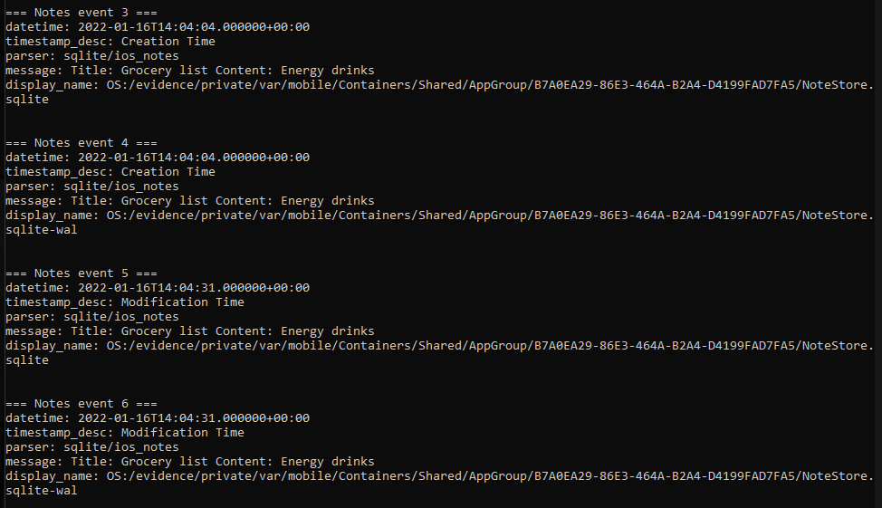

Path sumber yang ditemukan:

```text
private/var/mobile/Containers/Shared/AppGroup/B7A0EA29-86E3-464A-B2A4-D4199FAD7FA5/NoteStore.sqlite
```

Discovery skema menemukan `ZICCLOUDSYNCINGOBJECT` dan `ZICNOTEDATA`. Record judul `Grocery list` memiliki `Z_PK=4`, referensi data `1`, serta back-reference `ZNOTE=4`. Payload berukuran 318 byte diawali `1f 8b`, lalu berhasil didekompresi sebagai GZIP.

```python
import gzip, re
from bantu_bukti import SOURCE, copied_database
path = SOURCE / 'private/var/mobile/Containers/Shared/AppGroup/B7A0EA29-86E3-464A-B2A4-D4199FAD7FA5/NoteStore.sqlite'
with copied_database(path) as con:
    query = '''
    SELECT n.Z_PK AS note_id, n.ZTITLE1 AS title, n.ZSNIPPET AS snippet,
           n.ZNOTEDATA AS reference, d.Z_PK AS data_id,
           d.ZNOTE AS back_reference, d.ZDATA AS payload
    FROM ZICCLOUDSYNCINGOBJECT n
    JOIN ZICNOTEDATA d ON d.Z_PK=n.ZNOTEDATA
    WHERE n.ZTITLE1=?
    '''
    rows = con.execute(query, ('Grocery list',)).fetchall()
    print('Matching records:', len(rows))
    for row in rows:
        print({k: row[k] for k in row.keys() if k != 'payload'})
        payload = row['payload']
        print('Payload bytes:', len(payload), 'Signature:', payload[:8].hex(' '))
        raw = gzip.decompress(payload)
        print('Readable ASCII segments, not a complete format decode:')
        for part in re.findall(rb'[\x20-\x7e]{4,}', raw):
            print(part.decode('ascii'))
```

Hasil teks yang terbaca:

```text
:Grocery list
Energy drinks
Bread
Hand soap
Birthday card
```

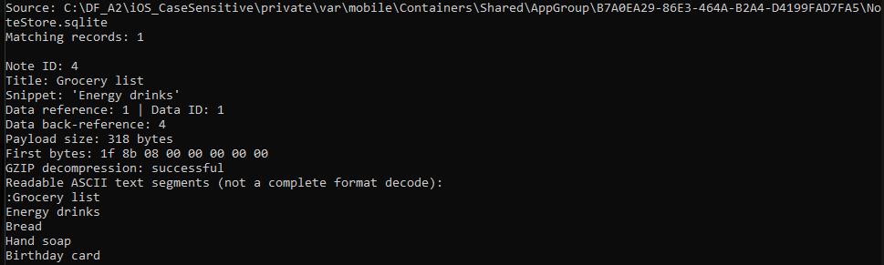

**Jawaban:** empat barang, tidak termasuk judul. **Keterbatasan:** hasil Plaso yang diperiksa hanya menampilkan snippet `Energy drinks`. Ekstraksi ASCII sesudah GZIP adalah pemeriksaan parsial payload, bukan decoder lengkap struktur note/protobuf, status checklist, atau format rich text. Jumlah empat ditetapkan dari empat nama barang yang teridentifikasi, bukan dari jumlah event atau jumlah seluruh segmen ASCII.

### 8.2 Lokasi terakhir ponsel

**Discovery:** pencarian `latitude`, `longitude`, `location`, `gps`, dan `coordinates` pada pesan menghasilkan kandidat dari beberapa parser. `unified_logging` mendominasi dengan 500.138 kecocokan pada pencarian awal. Kandidat juga muncul pada file resource, data usage, Safari, dan cookie. Timestamp expiration cookie hingga 2042 bukan bukti keberadaan perangkat pada tahun tersebut.

Pencarian koordinat pada unified logs menghasilkan 50.921 kandidat. Lima kandidat terakhir yang awalnya ditampilkan menyebut Cupertino dan New York dalam daftar lokasi yang disinkronkan. Itu bukan bukti posisi aktual ponsel. Penyempitan pada proses `/usr/libexec/locationd` menghasilkan 22.197 kecocokan istilah koordinat dan 224.224 pesan bertanda `<private>` dalam pencarian sesi tersebut. Angka ini merupakan hasil filter yang berbeda dan dapat saling tumpang tindih.

Sampel `latitude <private>` dan `longitude <private>` tidak mengungkap nilai koordinat. Penanda `<decode: unsupported decoder: location:CLSubHarvesterIdentifier>` juga muncul pada salah satu event. Penyembunyian `<private>` dibedakan dari decoder yang tidak didukung. Beberapa sampel tidak membuktikan seluruh log lokasi tidak berguna.

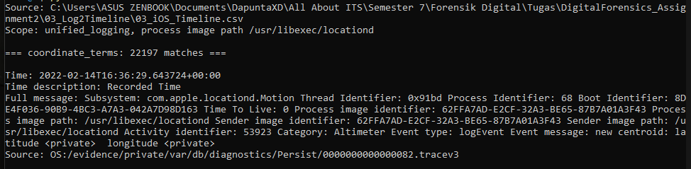

Pemeriksaan manual dilanjutkan dengan inventaris database dan kolom terkait lokasi. Discovery skema awal mengidentifikasi kandidat tabel; tahap tersebut belum setara dengan query akhir yang memperhitungkan WAL. Kandidat cache `routined` dipilih setelah tabel `ZRTCLLOCATIONMO` ditemukan.

Sumber:

```text
private/var/mobile/Library/Caches/com.apple.routined/Cache.sqlite
private/var/mobile/Library/Caches/com.apple.routined/Cloud-V2.sqlite
```

```python
from bantu_bukti import SOURCE, copied_database, apple_time
base = SOURCE / 'private/var/mobile/Library/Caches/com.apple.routined'
for name in ('Cache.sqlite', 'Cloud-V2.sqlite'):
    with copied_database(base / name) as con:
        print('Row count:', con.execute('SELECT COUNT(*) FROM ZRTCLLOCATIONMO').fetchone()[0])
        query = '''SELECT Z_PK, ZTYPE, ZLATITUDE, ZLONGITUDE, ZTIMESTAMP,
                          ZHORIZONTALACCURACY, ZVERTICALACCURACY
                   FROM ZRTCLLOCATIONMO WHERE ZTIMESTAMP IS NOT NULL
                   ORDER BY ZTIMESTAMP DESC LIMIT 3'''
        for row in con.execute(query):
            print(dict(row))
            print('UTC, Apple epoch:', apple_time(row['ZTIMESTAMP']))
```

`Cache.sqlite` memuat 4.084 record pada tabel tersebut. `Cloud-V2.sqlite` memuat nol record pada tabel yang sama.

| Field record terbaru | Nilai |
|---|---|
| `Z_PK` | `15107` |
| `ZTYPE` | `6`; makna tipe tidak ditetapkan dalam pemeriksaan ini |
| `ZLATITUDE` | `38.84412764999998` |
| `ZLONGITUDE` | `-77.28686522999998` |
| `ZTIMESTAMP` | `666555963.105048` |
| UTC, epoch Apple 2001 | `2022-02-14T18:26:03.105048+00:00` |
| `ZHORIZONTALACCURACY` | `1414.0` meter |
| `ZVERTICALACCURACY` | `-1.0`; tidak dipakai sebagai ukuran akurasi vertikal positif |

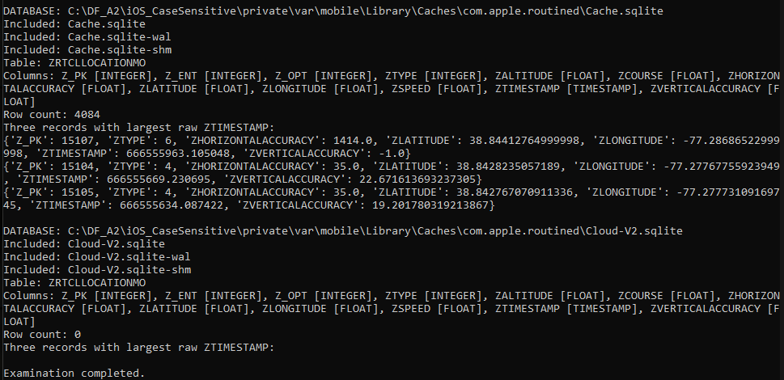

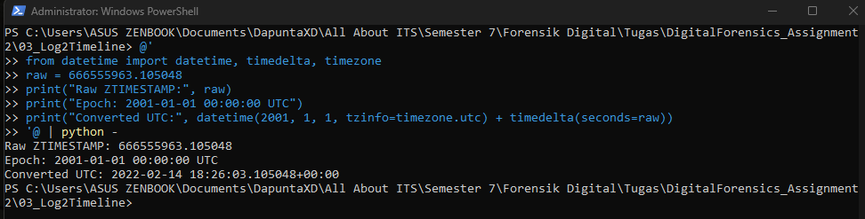

**Jawaban dengan batas:** koordinat tersebut adalah lokasi terbaru pada tabel yang diperiksa. Ketelitian sekitar 1,4 km tidak mendukung identifikasi bangunan tertentu. Pemeriksaan ini belum membandingkan seluruh sumber lokasi perangkat. **Atribusi:** koordinat dan konversi waktu diperoleh melalui SQL/Python pada file sumber, bukan hasil parsing lokasi langsung Plaso atau hasil ingest Autopsy.

### 8.3 Waktu reboot terakhir

**Discovery:** pencarian `boot`, `reboot`, dan `restart` pada pesan menghasilkan 22.571 kandidat unified logging, 80 launchd, 35 sysdiag, serta dua pesan Discord. Percakapan tentang me-restart server Minecraft atau laptop bukan bukti reboot iPhone.

`launchd.log` ditemukan melalui hasil pencarian, lalu diperiksa sebagai sumber:

```powershell
$LaunchdLog = Join-Path $EvidencePath 'private\var\log\com.apple.xpc.launchd\launchd.log'
Get-Content -LiteralPath $LaunchdLog -TotalCount 15
Select-String -LiteralPath $LaunchdLog -Pattern '\bboot\b|\breboot\b|\brestart\b' |
    Select-Object -Last 12 | Format-List Path, LineNumber, Line
```

Awal log menampilkan `2022-02-14 13:25:46.504387 <Notice>: hello`, boot arguments, dan rangkaian boot task. `Early boot complete` tercatat pada `13:25:47.992966`. Zona waktu pada teks log tidak eksplisit. Tanggal dan `PDT` pada banner versi Darwin adalah informasi build, bukan otomatis zona waktu runtime.

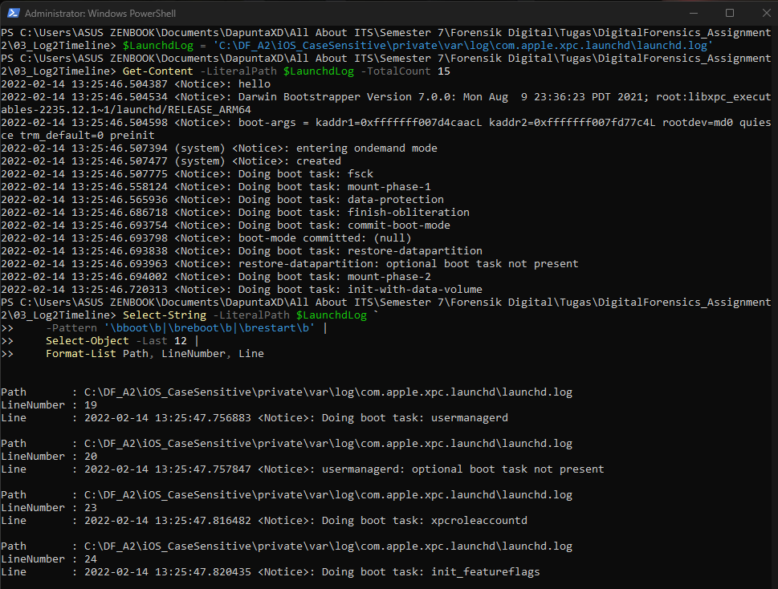

Pengelompokan event unified logging menurut **Boot Identifier** menemukan sepuluh identifier. Pengelompokan memakai minimum dan maksimum timestamp, bukan posisi terakhir pada CSV. Lima sesi dengan event teramati paling akhir:

| Boot Identifier | Event pertama teramati UTC | Event terakhir teramati UTC |
|---|---|---|
| `E9D38A12-6CB8-4E52-A3D1-797FE34CD77A` | 2022-02-14 18:24:19.433593 | 2022-02-14 18:33:27.509776 |
| `D2462B8A-F486-42DB-A56E-E42CAB672D95` | 2022-02-14 18:18:27.217651 | 2022-02-14 18:21:27.668521 |
| `BA3346EF-50EE-437C-BACD-1A9EDC9C663F` | 2022-02-14 18:16:28.304748 | 2022-02-14 18:18:14.646479 |
| `C345CFD0-7D80-4289-A603-BC2F35F874F1` | 2022-02-14 18:08:17.204010 | 2022-02-14 18:10:19.385168 |
| `A6DBA171-08B4-4D6D-AA0F-D024A43008E8` | 2022-02-14 18:03:18.281799 | 2022-02-14 18:05:00.481807 |

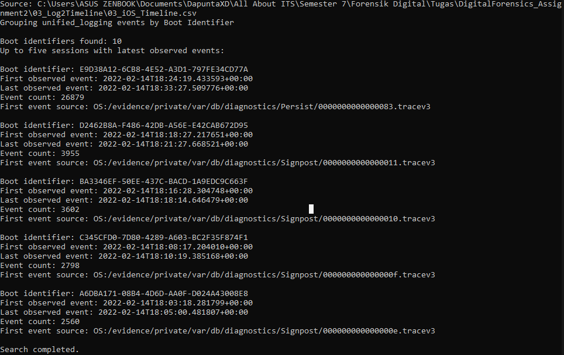

Sesi terbaru memuat 26.879 event. Waktu pertama teramati tidak digunakan sendirian sebagai waktu boot. Pemeriksaan event awal kemudian menemukan marker eksplisit:

```text
datetime: 2022-02-14T18:24:19.433593+00:00
parser: unified_logging
Event type: timesyncEvent
Event message: === system boot: E9D38A12-6CB8-4E52-A3D1-797FE34CD77A
```

Marker yang sama muncul pada:

```text
private/var/db/diagnostics/Persist/0000000000000083.tracev3
private/var/db/diagnostics/Special/000000000000008b.tracev3
private/var/db/diagnostics/Special/000000000000008c.tracev3
```

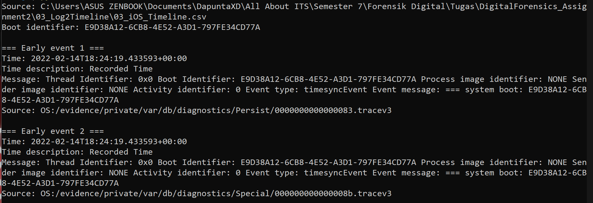

**Jawaban:** reboot terakhir yang teridentifikasi adalah **14 Februari 2022, 18:24:19.433593 UTC**, menurut marker hasil parsing Plaso. Tiga representasi marker dengan Boot Identifier sama adalah satu sesi boot, bukan tiga reboot.

Event berikutnya memuat `=== system wallclock time adjusted` pada `18:25:48.187945 UTC`. Karena ada penyesuaian jam, timestamp dilaporkan sebagaimana direpresentasikan tool dan tidak disamakan begitu saja dengan teks waktu lokal pada launchd. Penyebab reboot dan apakah dilakukan pengguna tidak ditentukan. Temuan ini memperbarui kesimpulan sebelumnya yang hanya memakai baris `Reboot detected`; waktu deteksi service tidak otomatis sama dengan awal boot sistem.

### 8.4 Waktu pembuatan akun Reddit

**Discovery:** pencarian `reddit` pada CSV mengungkap container dan nama preferensi terkait akun `ivu21eum`. Setelah identifier ditemukan melalui data, pencarian nama file dilakukan:

```powershell
Get-ChildItem -LiteralPath $EvidencePath -Recurse -File -Filter '*ivu21eum*' |
    Select-Object FullName, Length | Format-List
```

Ditemukan file pada `Documents/release02/geoRegions/ivu21eum` serta file akun pada AppGroup. Nama sama tidak cukup; file akun dipilih berdasarkan path dan struktur internal.

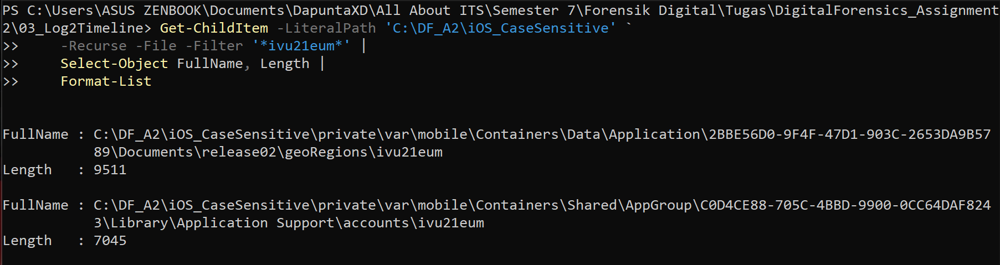

Sumber file akun:

```text
private/var/mobile/Containers/Shared/AppGroup/C0D4CE88-705C-4BBD-9900-0CC64DAF8243/Library/Application Support/accounts/ivu21eum
```

File berukuran 7.045 byte, diawali `bplist00`, dan memuat NSKeyedArchiver dengan 127 objek. `$top.root` mengarah ke objek `Account`; `kRedditorKey` mengarah ke `User`.

```python
from bantu_bukti import SOURCE, checked_plist, Archive, apple_time
path = SOURCE / 'private/var/mobile/Containers/Shared/AppGroup/C0D4CE88-705C-4BBD-9900-0CC64DAF8243/Library/Application Support/accounts/ivu21eum'
with checked_plist(path) as raw:
    a = Archive(raw)
    account = a.root
    redditor = a.field(account, 'kRedditorKey')
    print('Username:', a.field(redditor, 'Username'))
    values = []
    for label, obj in [('Account', account), ('Redditor', redditor)]:
        date = a.field(obj, 'created')
        seconds = date['NS.time']
        values.append(seconds)
        print(label, 'NS.time:', seconds, 'UTC:', apple_time(seconds))
    print('Created values match:', values[0] == values[1])
```

Username adalah `PogProgrammer`. Nilai `created` akun dan redditor sama, masing-masing `NS.time=664495178.0`, yang menghasilkan **2022-01-21 21:59:38 UTC** dengan epoch Apple 2001.

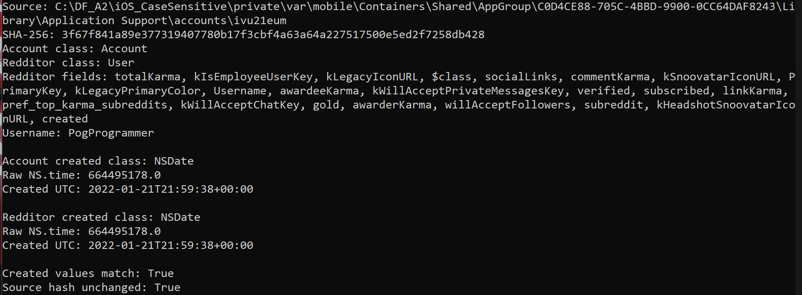

**Atribusi dan batas:** Plaso membantu menemukan jejak container/akun; nilai pembuatan dibaca melalui decoding manual. Tidak ditemukannya jawaban terstruktur pada hasil yang diperiksa belum membuktikan seluruh dukungan Reddit pada Plaso tidak tersedia. Hash sumber tetap sama selama pemeriksaan.

### 8.5 Aplikasi yang dihapus

**Discovery:** pencarian umum `uninstall` pada pesan menemukan 169 event unified logging dan tiga event `text/ios_sysdiag_log`. Pesan penghapusan suggestion untuk aplikasi yang di-uninstall bukan bukti identitas aplikasi tertentu. Event sysdiag menunjukkan:

```text
2022-01-21T17:11:26.000000+00:00
Uninstall requested ... identifier com.tencent.xin
Uninstalling identifier com.tencent.xin
```

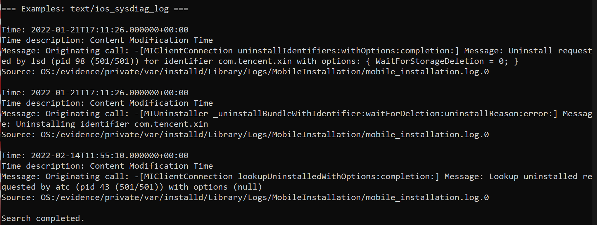

Bundle identifier kemudian digunakan untuk pemeriksaan konteks file sumber yang telah ditemukan:

```powershell
$InstallLog = Join-Path $EvidencePath 'private\var\installd\Library\Logs\MobileInstallation\mobile_installation.log.0'
Select-String -LiteralPath $InstallLog `
    -SimpleMatch 'Uninstalling identifier com.tencent.xin' -Context 5,15
# Tampilan lebih ringkas untuk dokumentasi bagian yang relevan:
Get-Content -LiteralPath $InstallLog | Select-Object -Skip 848 -First 14
```

Baris 849 mencatat permintaan uninstall, 852 proses uninstall, 853 penghancuran bundle container, dan 854 penghancuran data container. Baris 855 sampai 858 memuat extension, termasuk `com.tencent.xin.WeChatNotificationServiceExtension`. Hubungan ini mendukung identifikasi **WeChat** dari bukti lokal.

Baris 862 pada detik berikutnya menyatakan bundle container tidak ditemukan setelah permintaan berulang. Konteks tersebut konsisten dengan container yang telah dihapus, bukan dasar untuk menyimpulkan uninstall awal gagal. Event lookup uninstalled pada 14 Februari juga bukan event uninstall baru.

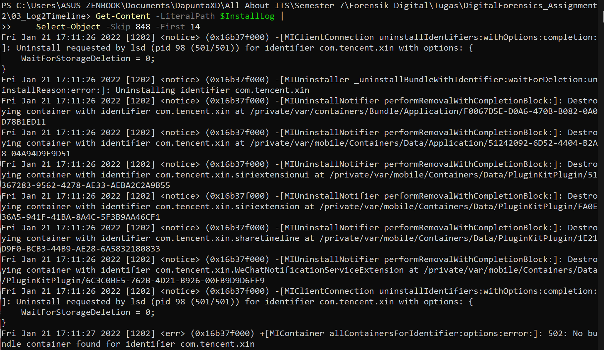

**Jawaban:** WeChat. **Zona waktu:** raw log menyatakan `Fri Jan 21 17:11:26 2022` tanpa offset. Walaupun CSV menampilkan `+00:00`, zona waktu asal log belum terverifikasi. Waktu tersebut tidak dilabeli sebagai UTC yang telah dikonfirmasi secara independen. **Metode:** bukti uninstall langsung tersedia melalui parser Plaso, dengan pemeriksaan konteks manual sebagai verifikasi.

### 8.6 Isi notifikasi Reddit terakhir

**Discovery:** pencarian Reddit bersama `notification`, `push`, atau `bulletin` menghasilkan 2.127 unified log, 106 powerlog, 10 data usage, tujuh sysdiag, dan empat launchd. Sampel mencakup instalasi, aktivitas notification extension, dan validasi container, belum mengungkap isi notifikasi.

Aktivitas extension pada powerlog pukul `16:59:52 UTC` bukan timestamp penerimaan notifikasi. Pesan error validasi metadata berasal dari iOS yang dicatat di dalam log; itu berbeda dari error parser Plaso.

Pencarian nama direktori dilanjutkan pada sumber. `-Filter '*notification*'` pada percobaan pertama tidak menampilkan semua direktori yang dibutuhkan di lingkungan case-sensitive. Enumerasi dan pencocokan eksplisit tanpa membedakan kapital menghasilkan kandidat lengkap:

```powershell
$MobileLibrary = Join-Path $EvidencePath 'private\var\mobile\Library'
Get-ChildItem -LiteralPath $MobileLibrary -Recurse -Force -Directory |
    Where-Object { $_.Name -imatch 'notification' } |
    Select-Object FullName, Attributes | Format-List
$NotificationPath = Join-Path $MobileLibrary 'UserNotifications'
Get-ChildItem -LiteralPath $NotificationPath -Force |
    Select-Object Mode, Name, Length | Format-Table -AutoSize
```

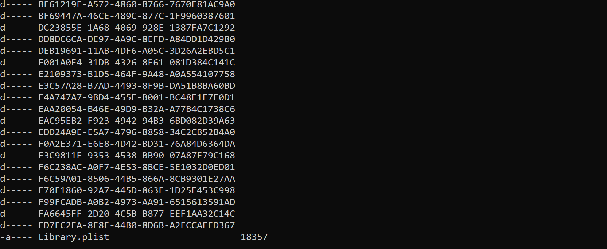

Folder UUID tidak ditebak. `Library.plist` dibuka sebagai NSKeyedArchiver dan pasangan NSDictionary dipetakan dari `NS.keys` serta `NS.objects`:

```python
from bantu_bukti import SOURCE, checked_plist, Archive
base = SOURCE / 'private/var/mobile/Library/UserNotifications'
with checked_plist(base / 'Library.plist') as raw:
    a = Archive(raw)
    mapping = a.dictionary(a.root)
    folder = mapping['com.reddit.Reddit']
    print('Application: com.reddit.Reddit')
    print('Mapped value:', folder)
    for path in sorted((base / folder).iterdir()):
        if path.is_file():
            print(path.name, path.stat().st_size, 'bytes')
```

Mapping mengarah ke `F6C59A01-8506-44B5-866A-8CB9301E27AA`, yang memuat `AttachmentsList.plist`, `Categories.plist`, `DeliveredNotifications.plist`, dan `PushRegistration.plist`.

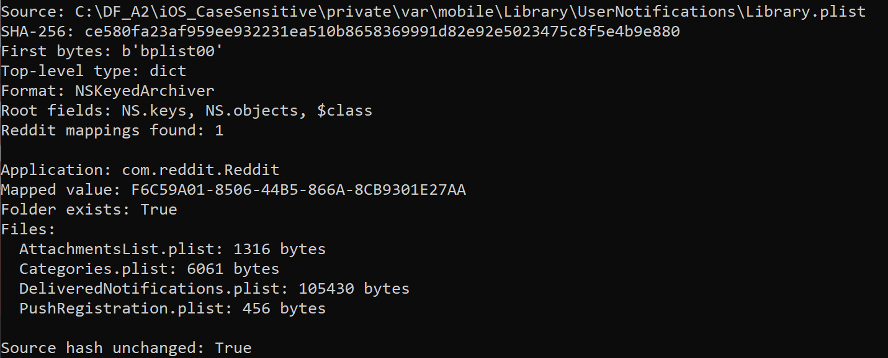

Setelah mapping dikonfirmasi, seluruh timestamp pembuatan dalam delivered notifications dibandingkan:

```python
from bantu_bukti import SOURCE, checked_plist, Archive, apple_time
path = SOURCE / 'private/var/mobile/Library/UserNotifications/F6C59A01-8506-44B5-866A-8CB9301E27AA/DeliveredNotifications.plist'
with checked_plist(path) as raw:
    a = Archive(raw)
    entries = [a.dictionary(ref) for ref in a.root['NS.objects']]
    valid = []
    for entry in entries:
        date = entry.get('AppNotificationCreationDate')
        if isinstance(date, dict) and isinstance(date.get('NS.time'), (int, float)):
            valid.append((date['NS.time'], entry))
    print('Notification count:', len(entries))
    print('Entries with validated dates:', len(valid))
    if not valid or len(valid) != len(entries):
        raise RuntimeError('Incomplete date validation; review all entries before claiming latest')
    maximum = max(seconds for seconds, _ in valid)
    latest = [entry for seconds, entry in valid if seconds == maximum]
    print('Maximum NS.time:', maximum, 'Creation UTC:', apple_time(maximum))
    print('Entries at maximum:', len(latest))
    for entry in latest:
        for key in ('AppNotificationIdentifier', 'AppNotificationTitle', 'AppNotificationMessage'):
            print(key + ':', entry.get(key))
```

Terdapat 22 notifikasi dengan tanggal tervalidasi; satu record memiliki timestamp maksimum `666550798.3817372`.

| Field | Nilai |
|---|---|
| Creation UTC | `2022-02-14T16:59:58.381737+00:00` |
| Judul | `r/rupaulsdragrace` |
| Isi | `Kornbread and Jorgeous are still Making Fun of Cynthia's Car Crash...` |
| Identifier | `77AC661A-7B6D-4B70-AD3F-C8016D3643C1` |

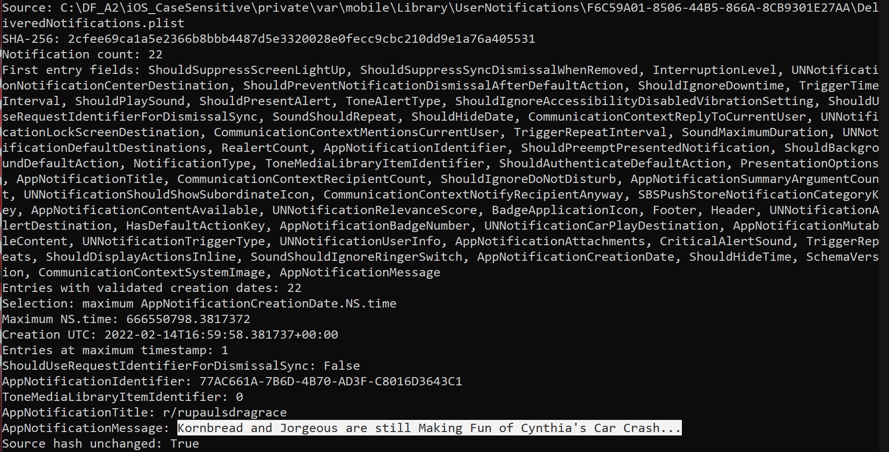

**Batas:** ini adalah record terbaru menurut `AppNotificationCreationDate` pada file yang diperiksa. Nilai tersebut tidak secara terpisah membuktikan waktu paket push tiba. Isi dipertahankan termasuk tiga titik di akhir. **Metode:** decoding manual, tidak diklaim sebagai isi notifikasi yang berhasil dikeluarkan parser Plaso. Kegagalan filter direktori merupakan masalah penelusuran manual, bukan kegagalan parsing Plaso.

### 8.7 Suara alarm

**Discovery:** pencarian alarm pada CSV menghasilkan 9.808 unified logs, 15 fseventsd, 12 launchd, empat plist, dan satu sysdiag pada pencarian sesi tersebut. Tujuh unified log juga memuat istilah audio/sound, tetapi contoh yang diperiksa hanya membahas volume dan status audio.

Parser `plist/plist_default` menunjukkan path `/MTAlarms/MTAlarms/$MTAlarm/MTAlarmLastModifiedDate` pada `com.apple.mobiletimerd.plist`. Petunjuk inilah yang digunakan untuk memilih file preferensi.

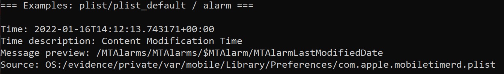

```python
from bantu_bukti import SOURCE, checked_plist
path = SOURCE / 'private/var/mobile/Library/Preferences/com.apple.mobiletimerd.plist'
with checked_plist(path) as data:
    alarms = data['MTAlarms']['MTAlarms']
    print('Alarm count:', len(alarms))
    for item in alarms:
        alarm = item['$MTAlarm']
        for key in ('MTAlarmID', 'MTAlarmTitle', 'MTAlarmEnabled', 'MTAlarmHour', 'MTAlarmMinute'):
            print(key + ':', alarm.get(key))
        print('Sound:', alarm['MTAlarmSound']['$MTSound'])
```

Terdapat satu alarm biasa dengan judul `Bed Bath and Beyond Opens`, jam `10`, menit `0`, identifier `6D8972C3-A55A-46BA-9567-0F8C5311A386`, dan `MTAlarmEnabled=False`. Nilai suara adalah `MTSoundToneID='system:Radar'`; vibration identifier adalah `synchronizedvibration:Radar`. Daftar sleep alarms berisi nol entri.

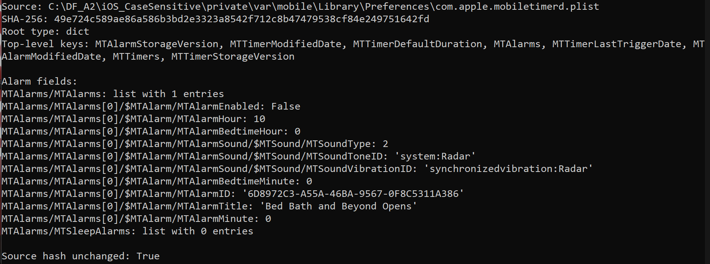

**Jawaban:** Radar. Status nonaktif tidak menghapus pilihan suara yang tersimpan. Data ini tidak membuktikan alarm benar-benar berbunyi. **Atribusi:** Plaso menghasilkan petunjuk timestamp/path, sedangkan nama suara dibaca manual. `MTSoundType=2` tidak diinterpretasikan lebih jauh tanpa validasi tambahan. Timer dan alarm tidak disamakan.

### 8.8 GIF yang diterima melalui Bumble

**Discovery:** pencarian `bumble` pada pesan atau path CSV menemukan bundle ID `com.moxco.bumble`, file preferensi, serta aktivitas aplikasi. Contoh event instalasi dan usage bukan isi chat. Label parser `sqlite/mackeeper_cache` pada cache URL tidak berarti aplikasi MacKeeper terpasang di iPhone.

File preferensi dan FSEvents mengarahkan penelusuran ke data container:

```text
private/var/mobile/Containers/Data/Application/F6664A1F-E4CE-412A-B6F6-825A08EDCC34
```

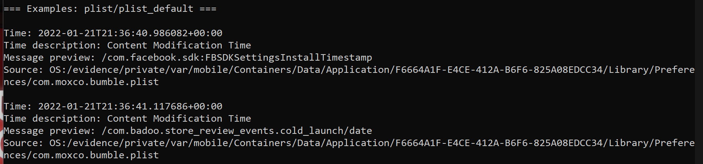

Penelusuran database dalam container dilakukan sebelum menetapkan tabel chat:

```powershell
$BumblePath = Join-Path $EvidencePath 'private\var\mobile\Containers\Data\Application\F6664A1F-E4CE-412A-B6F6-825A08EDCC34'
Get-ChildItem -LiteralPath $BumblePath -Recurse -File |
    Where-Object { $_.Name -match '\.(sqlite|db)$' } |
    Select-Object FullName, Length | Format-List
```

`Library/Caches/Chat.sqlite` dan `GiphyAnalyticsPendingActions.sqlite` diperiksa bersama WAL/SHM. Integrity check keduanya `ok`. Pada `Chat.sqlite`, tabel `database2` memuat 18 record, sedangkan indeks pesan `secondaryIndex_isReadIndex` memuat delapan record. Kolom `data` bertipe BLOB. Pada database GiphyAnalytics yang diperiksa, `database2` dan `yap2` kosong; nama database tidak membuktikan isi pesan GIF tersedia di sana.

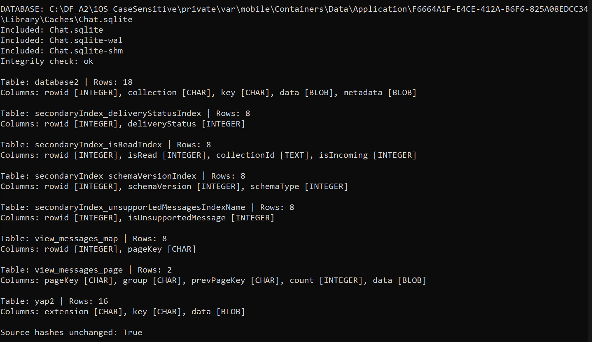

Setelah skema diketahui, join berdasarkan `rowid` menghubungkan payload ke arah pesan. BLOB dibuka sebagai NSKeyedArchiver. Pada objek pesan, nama field menggunakan prefix `self.`:

```python
from bantu_bukti import SOURCE, copied_database, Archive
import plistlib
path = SOURCE / 'private/var/mobile/Containers/Data/Application/F6664A1F-E4CE-412A-B6F6-825A08EDCC34/Library/Caches/Chat.sqlite'
with copied_database(path) as con:
    print('Integrity check:', con.execute('PRAGMA integrity_check').fetchone()[0])
    query = '''SELECT d.rowid, d.key, d.collection, d.data, i.isIncoming
               FROM database2 d JOIN secondaryIndex_isReadIndex i ON i.rowid=d.rowid
               ORDER BY d.rowid'''
    for row in con.execute(query):
        a = Archive(plistlib.loads(row['data']))
        msg = a.root
        print('\nRow ID:', row['rowid'], 'Key:', row['key'], 'isIncoming:', row['isIncoming'])
        print('Conversation collection:', row['collection'])
        for field in ('self.fromPersonUid', 'self.toPersonUid', 'self.dateCreated', 'self.messageText'):
            print(field + ':', a.resolve(msg.get(field)))
        gif = a.resolve(msg.get('self.gifMessageInfo'))
        if gif is not None:
            print('GIF metadata:', gif)
```

Delapan pesan yang diperiksa memuat percakapan Minecraft, perpindahan komunikasi ke Discord, dan satu URL GIPHY. Record kunci:

```text
Row ID: 19
Key: 4312590383
isIncoming: 1
Conversation collection: 1720690316
Raw dateCreated: 1643942797 (integer)
Message: https://giphy.com/embed/cXCVTR1wUn1a8
GIF metadata: BMGifMessageInfo
```

`isIncoming=1` didukung pola identifier pengirim/penerima yang berbalik dibanding pesan keluar pada percakapan yang sama. Pesan sebelumnya menyebut `DesertBusDriver#9827`; pesan keluar berikutnya menyebut `PostMaster#9650`. Nama akun Discord merupakan isi pesan, bukan verifikasi mandiri identitas sipil pengirim.

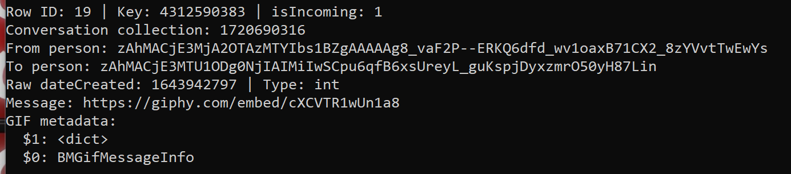

URL lokal dipakai untuk memperoleh ID GIF, lalu ID dicocokkan dengan [halaman GIPHY](https://giphy.com/gifs/80s-movies-three-amigos-john-landis-cXCVTR1wUn1a8). Judul yang teramati adalah **thirsty steve martin GIF**.

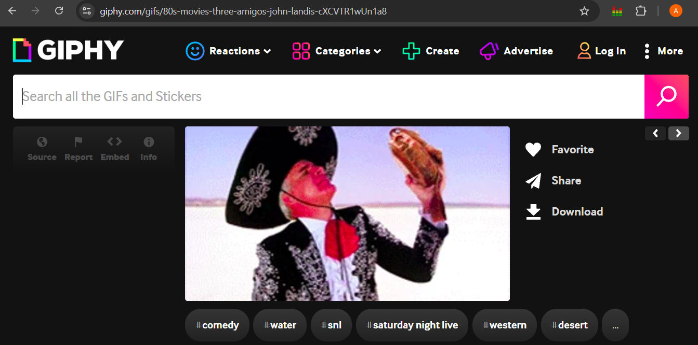

**Metode dan batas:** bukti pesan masuk berasal dari database sumber melalui SQL dan decoding manual; nama GIF berasal dari halaman eksternal saat pemeriksaan. Tidak diklaim bahwa judul lengkap tersimpan pada database atau tidak pernah berubah sejak pesan dikirim. Raw integer `dateCreated` tidak diperlakukan sebagai NSDate secara otomatis; pertanyaan nama GIF tidak memerlukan penetapan epoch dari field tersebut. Pemeriksaan tidak membuktikan seluruh data Bumble tidak didukung Plaso, hanya bahwa isi chat ini diperoleh melalui metode manual.

## 9. Warning dan error ekstraksi

### 9.1 Klasifikasi agar tidak salah atribusi

| Jenis masalah | Contoh | Kesimpulan yang dibenarkan |
|---|---|---|
| Warning parser/plugin | Action type knowledgeC tidak didukung | Jenis record tersebut tidak berhasil ditangani plugin pada percobaan itu |
| Error pemrosesan internal | Variabel `required_format` belum memiliki nilai | Operasi gagal; tidak cukup untuk menyatakan file sumber rusak |
| Kegagalan akses database sementara | `/tmp/...-wal` tidak ditemukan | Gagal membuka DB/WAL pada jalur kerja sementara, bukan bukti WAL sumber tidak tersedia |
| Indikasi ketidaksesuaian format/parser | `utmp` terhadap `.lstm`, `cups_ipp` terhadap indeks Spotlight | Perlu membedakan kandidat parser yang tidak cocok dari artefak relevan yang rusak |
| Error koordinasi task | Status task unknown | Ada masalah sebelum penggabungan; cakupan kehilangan event belum terukur |
| Pembatasan isi sumber | `<private>` pada unified logging | Nilai tidak terlihat pada representasi yang diperiksa; berbeda dari error decoder |
| Kegagalan laporan | `pinfo` TypeError | Pelaporan warning bermasalah; tidak otomatis seluruh storage gagal |
| Keterbatasan output yang diperiksa | Snippet notes belum memuat semua barang | Memerlukan pemeriksaan manual; tidak otomatis seluruh file gagal diparse |
| Masalah skrip pembaca host | CSV NUL pada Python 3.10 | Penyesuaian pembacaan diperlukan; tidak otomatis kegagalan parser Plaso |

### 9.2 Contoh plist dan error internal

Warning **0** menyatakan plugin `airport` gagal memparse `Chess.app/Tips.plist` karena `'list' object has no attribute 'keys'`. Parser chain adalah `plist`. Pesan mengindikasikan operasi dictionary diterapkan pada list. Satu plugin gagal tidak membuktikan tidak ada plugin lain yang menghasilkan informasi dari file tersebut.

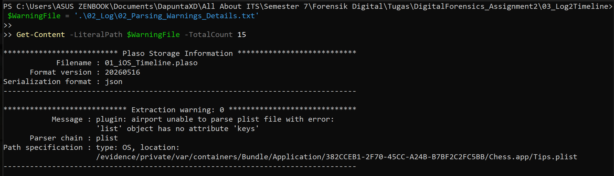

Warning **11** pada file sama menyatakan `cannot access local variable 'required_format' where it is not associated with a value`. Parser chain kosong. Atribusi plugin tertentu tidak ditetapkan karena kolom tersebut kosong.

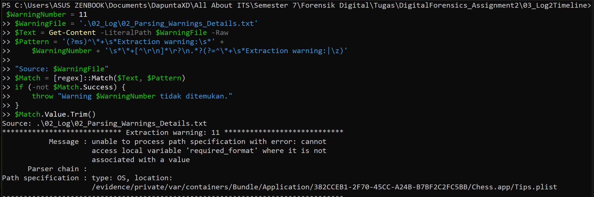

### 9.3 Kegagalan SQLite dan jenis action

Warning **36**: `unable to open SQLite database and WAL` dengan `[Errno 2] No such file or directory: '/tmp/tmpd9ixjdd6-wal'` saat memproses AddressBook. Path `/tmp` adalah lingkungan kerja container. File yang disebut hilang bukan path bukti asli.

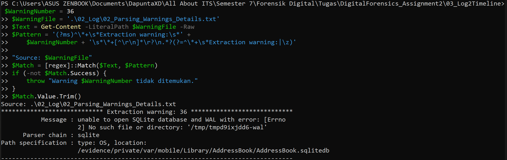

Warning **4090**: `unsupported action type: /discoverability/signals` pada `knowledgeC.db`, parser chain `sqlite/mac_knowledgec`. Ini bukti spesifik ketidakmampuan plugin memproses action type tersebut, bukan seluruh database.

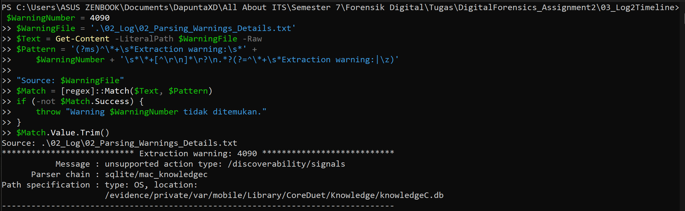

| Warning | Path sumber relatif terhadap `/evidence/` | Jenis file / konteks |
|---|---|---|
| 0 dan 11 | `private/var/containers/Bundle/Application/382CCEB1-2F70-45CC-A24B-B7BF2C2FC5BB/Chess.app/Tips.plist` | Property list aplikasi Chess |
| 36 | `private/var/mobile/Library/AddressBook/AddressBook.sqlitedb` | Database SQLite AddressBook |
| 389 | `private/var/MobileAsset/AssetsV2/com_apple_MobileAsset_LinguisticData/f498b0afd7d0b51eccab6e1175c3b160e4431d4f.asset/AssetData/Polarity-en.lstm` | Aset linguistik; warning parser `utmp` pada offset `0x00000180` |
| 4090 | `private/var/mobile/Library/CoreDuet/Knowledge/knowledgeC.db` | Database SQLite aktivitas CoreDuet |
| 9427 | `private/var/mobile/Library/Spotlight/CoreSpotlight/NSFileProtectionComplete/index.spotlightV2/dbStr-2.map.data` | Data indeks Spotlight; parser `cups_ipp`, unsupported group start tag `0x00` |

Ekstensi/path aset linguistik dan indeks menunjukkan indikasi ketidaksesuaian parser. Tanpa identifikasi format tambahan, tidak dinyatakan bahwa file tersebut adalah log utmp atau data printer IPP yang rusak.

### 9.4 Menampilkan blok warning tertentu

```powershell
$WarningNumber = 11  # Gunakan 36 atau 4090 untuk contoh lainnya.
$WarningFile = '.\02_Log\02_Parsing_Warnings_Details.txt'
$Text = Get-Content -LiteralPath $WarningFile -Raw
$Pattern = '(?ms)^\*+\s*Extraction warning:\s*' +
    $WarningNumber + '\s*\*+[^\r\n]*\r?\n.*?(?=^\*+\s*Extraction warning:|\z)'
"Source: $WarningFile"
$Match = [regex]::Match($Text, $Pattern)
if (-not $Match.Success) { throw "Warning $WarningNumber tidak ditemukan." }
$Match.Value.Trim()
```

### 9.5 Ringkasan warning

```python
import re
from collections import Counter
from pathlib import Path
path = Path('02_Log/02_Parsing_Warnings_Details.txt')
text = path.read_text(encoding='utf-8-sig')
blocks = re.split(r'(?m)(?=^\*+\s*Extraction warning:\s*\d+)', text)
counts, ids = Counter(), []
for block in blocks:
    match = re.match(r'^\*+\s*Extraction warning:\s*(\d+)', block)
    if not match:
        continue
    ids.append(int(match.group(1)))
    parser = re.search(r'Parser chain\s*:[ \t]*([^\r\n]*)', block)
    name = parser.group(1).strip() if parser else ''
    counts[name or '(empty parser chain)'] += 1
print('Source:', path.resolve())
print('Extraction warning blocks:', len(ids))
print('Unique warning identifiers:', len(set(ids)))
for name, count in counts.most_common():
    print(name + ':', count)
print('Counts represent warnings, not unique files or lost events.')
```

| Parser chain | Warning |
|---|---:|
| `sqlite/mac_knowledgec` | 5.265 |
| `utmp` | 3.848 |
| `plist` | 475 |
| Kosong | 58 |
| `sqlite` | 5 |
| `cups_ipp` | 4 |
| **Total** | **9.655** |

Terdapat 9.655 identifier unik pada file detail yang diperiksa. Enam kategori mencakup satu nilai kosong, bukan enam plugin bernama. Kecocokan jumlah dengan ringkasan ekstraksi mendukung bahwa jumlah blok warning sesuai catatan sesi, tetapi tidak membuktikan setiap event berhasil dikeluarkan atau `pinfo` berakhir tanpa error.

Ringkasan tersimpan: [05_Parsing_Warnings_Summary.txt](./03_Dokumentasi/05_Parsing_Warnings_Summary.txt).

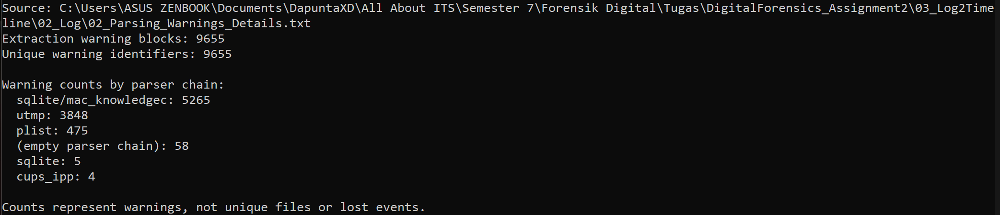

### 9.6 Error pengelolaan task ekstraksi

```powershell
$LogFile = '.\02_Log\01_Log2Timeline.log'
$Errors = @(Select-String -LiteralPath $LogFile -Pattern '\bERROR\b')
"Source: $LogFile"
"Lines containing ERROR: $($Errors.Count)"
$Errors | Select-Object -First 3 |
    ForEach-Object { "Line $($_.LineNumber): $($_.Line)" }
```

Hasil menunjukkan **54 baris yang memuat ERROR**. Tiga sampel pertama berisi `Unable to retrieve task ... to prepare it to be merged` dan `Status of task ... is unknown`. Ini berkaitan dengan pengambilan task untuk persiapan penggabungan, bukan contoh decoding artefak tertentu.

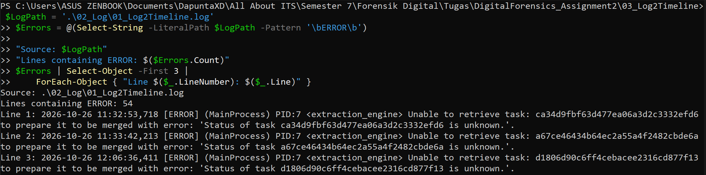

Jumlah baris tidak identik dengan jumlah task unik, file gagal, atau event hilang. Dari output yang ditampilkan, file sumber terdampak dan jumlah event yang tidak tergabung belum dapat ditentukan. Tidak dinyatakan bahwa 16.024.624 event mencakup semua event yang mungkin diekstraksi. Tidak ada ingest ulang yang dilakukan hanya untuk menyembunyikan atau menghilangkan catatan error tersebut.

## 10. Integritas, keterbatasan, dan status hasil

### 10.1 Pemisahan hasil tool dan pemeriksaan manual

| Pertanyaan | Kontribusi Plaso | Operasi tambahan |
|---|---|---|
| Belanja | Menemukan note, judul, snippet, timestamp, dan path | Query relasi note dan dekompresi BLOB |
| Lokasi | Menemukan kandidat aktivitas lokasi dan pembatasan nilai log | Inventaris SQLite, query routined dengan WAL, konversi waktu |
| Reboot | Mengeluarkan marker `system boot`, Boot Identifier, timestamp | Korelasi dengan launchd dan pemeriksaan sesi |
| Reddit account | Membantu discovery container/identifier | Decoding objek akun dan NSDate |
| Uninstall | Mengeluarkan event uninstall dan bundle ID | Memeriksa konteks penghapusan container/extension |
| Notifikasi Reddit | Memberikan jejak aktivitas, belum isi dalam hasil yang diperiksa | Mapping folder dan decoding notifikasi tersimpan |
| Alarm | Menemukan path preferensi dan timestamp | Membaca tone ID pada plist |
| GIF Bumble | Membantu discovery container dan aktivitas | Query/decoding BLOB chat serta konfirmasi GIPHY |

Analisis ini menggunakan metode hybrid. Pembacaan plist oleh `plistlib` tidak otomatis mendekode seluruh NSKeyedArchiver; referensi UID dan struktur NSDictionary/NSArray harus diikuti sesuai format. SQL membaca nilai BLOB tetapi tidak otomatis memahami struktur pesan di dalamnya.

### 10.2 Hash artefak yang tercatat

Nilai berikut berasal dari keluaran pemeriksaan yang didokumentasikan dalam sesi. Nilai yang belum tersedia tidak diisi dengan perkiraan.

| Artefak | SHA-256 |
|---|---|
| Reddit `accounts/ivu21eum` | `3f67f841a89e377319407780b17f3cbf4a63a64a227517500e5ed2f7258db428` |
| UserNotifications `Library.plist` | `ce580fa23af959ee932231ea510b8658369991d82e92e5023475c8f5e4b9e880` |
| Reddit `DeliveredNotifications.plist` | `2cfee69ca1a5e2366b8bbb4487d5e3320028e0fecc9cbc210dd9e1a76a405531` |
| `com.apple.mobiletimerd.plist` | `49e724c589ae86a586b3bd2e3323a8542f712c8b47479538cf84e249751642fd` |

Pemeriksaan SQLite mencatat kesamaan hash sumber sebelum dan sesudah pembacaan; kesamaan ini mendukung bahwa byte file yang dibandingkan tidak berubah selama interval pemeriksaan. Hal tersebut tidak membuktikan chain of custody lengkap sejak akuisisi atau kesempurnaan ekstraksi arsip. Hash timeline dan CSV belum dicantumkan karena nilai hasil komputasinya tidak tersedia dalam dokumentasi yang ditinjau.

### 10.3 Path setelah reorganisasi

Perpindahan hasil ke `01_Hasil` dan log ke `02_Log` tidak mengharuskan pengulangan ekstraksi atau psort. Kode yang membaca CSV relatif sekarang mengarah ke `01_Hasil/03_iOS_Timeline.csv`. Mount Docker untuk output sekarang menggunakan `$ResultPath`. Path sumber `C:\DF_A2\iOS_CaseSensitive` tidak berubah. Path `/evidence/...` di dalam CSV merupakan provenance saat pemrosesan dan tidak diubah agar menyesuaikan host.

Screenshot dan log lama dipertahankan dengan path yang benar pada saat pelaksanaan. Tidak ada kebutuhan mengedit isi screenshot untuk membuatnya tampak dijalankan dari struktur baru.

### 10.4 Batas cakupan akhir

- Full File System yang diperiksa merupakan kumpulan file hasil akuisisi/ekstraksi; bukan seluruh sektor media dan bukan seluruh data yang pernah ada.
- Event ganda dari main database/WAL atau beberapa trace tidak otomatis berarti tindakan pengguna berulang.
- Timestamp creation, modification, recorded time, expiration, dan waktu deteksi service memiliki makna berbeda.
- Data yang tidak tampil pada pencarian terbatas belum terbukti tidak ada pada sumber atau sama sekali tidak didukung tool.
- Warning plugin tidak selalu berarti seluruh file gagal; satu file dapat dicoba oleh beberapa plugin.
- Koordinat terakhir dibatasi pada tabel yang diperiksa dan memiliki ketelitian sekitar 1,4 km.
- Waktu boot mengikuti hasil representasi Plaso dan memiliki konteks penyesuaian jam.
- Bukti notifikasi dibatasi pada delivered notifications yang tersimpan; judul GIF dibatasi pada konfirmasi halaman eksternal saat pemeriksaan.
- Error task membuat kelengkapan timeline belum dapat dijamin. Dampak kuantitatifnya belum diketahui.

### 10.5 Status pekerjaan

Ekstraksi dan ekspor CSV telah selesai; delapan pertanyaan memiliki temuan dengan batas masing-masing; 31 screenshot tercantum pada struktur dokumentasi; warning dan error telah diperiksa. README ini mendokumentasikan pekerjaan Plaso beserta pemeriksaan manual pendamping. README tidak menggantikan laporan DOCX sesuai template dan tidak menyatakan pemeriksaan iLEAPP yang dikerjakan terpisah telah dilakukan di sini.

## 11. Indeks dokumentasi

Seluruh path gambar relatif terhadap lokasi README. Semua nama di bawah sesuai daftar folder yang disediakan; isi gambar yang tidak dibuka ulang pada penyusunan ini mengacu pada keluaran sesi dan dokumentasi yang telah dicatat.

| No. | File screenshot | Pokok bukti |
|---|---|---|
| 01 | [01_Plaso_Installation_Version.png](./03_Dokumentasi/Screenshots/01_Plaso_Installation_Version.png) | Plaso Installation Version |
| 02 | [02_Log2Timeline_Completed.png](./03_Dokumentasi/Screenshots/02_Log2Timeline_Completed.png) | Log2Timeline Completed |
| 03 | [03_Psort_Export_Completed.png](./03_Dokumentasi/Screenshots/03_Psort_Export_Completed.png) | Psort Export Completed |
| 04 | [04_Plaso_Parser_Inventory.png](./03_Dokumentasi/Screenshots/04_Plaso_Parser_Inventory.png) | Plaso Parser Inventory |
| 05 | [05_Notes_Grocery_List_Plaso.png](./03_Dokumentasi/Screenshots/05_Notes_Grocery_List_Plaso.png) | Notes Grocery List Plaso |
| 06 | [06_Notes_Payload_Inspection.png](./03_Dokumentasi/Screenshots/06_Notes_Payload_Inspection.png) | Notes Payload Inspection |
| 07 | [07_Location_Log_Private_Values.png](./03_Dokumentasi/Screenshots/07_Location_Log_Private_Values.png) | Location Log Private Values |
| 08 | [08_Routined_Location_Records.png](./03_Dokumentasi/Screenshots/08_Routined_Location_Records.png) | Routined Location Records |
| 09 | [09_Routined_Timestamp_Conversion.png](./03_Dokumentasi/Screenshots/09_Routined_Timestamp_Conversion.png) | Routined Timestamp Conversion |
| 10 | [10_Launchd_Boot_Sequence.png](./03_Dokumentasi/Screenshots/10_Launchd_Boot_Sequence.png) | Launchd Boot Sequence |
| 11 | [11_Unified_Log_Boot_Sessions.png](./03_Dokumentasi/Screenshots/11_Unified_Log_Boot_Sessions.png) | Unified Log Boot Sessions |
| 12 | [12_Last_System_Boot_Plaso.png](./03_Dokumentasi/Screenshots/12_Last_System_Boot_Plaso.png) | Last System Boot Plaso |
| 13 | [13_Reddit_Account_File_Discovery.png](./03_Dokumentasi/Screenshots/13_Reddit_Account_File_Discovery.png) | Reddit Account File Discovery |
| 14 | [14_Reddit_Account_Created_Manual.png](./03_Dokumentasi/Screenshots/14_Reddit_Account_Created_Manual.png) | Reddit Account Created Manual |
| 15 | [15_App_Uninstall_Plaso.png](./03_Dokumentasi/Screenshots/15_App_Uninstall_Plaso.png) | App Uninstall Plaso |
| 16 | [16_WeChat_Uninstall_Source_Context.png](./03_Dokumentasi/Screenshots/16_WeChat_Uninstall_Source_Context.png) | WeChat Uninstall Source Context |
| 17 | [17_UserNotifications_Directory.png](./03_Dokumentasi/Screenshots/17_UserNotifications_Directory.png) | UserNotifications Directory |
| 18 | [18_Reddit_Notification_Folder_Mapping.png](./03_Dokumentasi/Screenshots/18_Reddit_Notification_Folder_Mapping.png) | Reddit Notification Folder Mapping |
| 19 | [19_Reddit_Latest_Notification_Manual.png](./03_Dokumentasi/Screenshots/19_Reddit_Latest_Notification_Manual.png) | Reddit Latest Notification Manual |
| 20 | [20_Alarm_Preference_Discovery_Plaso.png](./03_Dokumentasi/Screenshots/20_Alarm_Preference_Discovery_Plaso.png) | Alarm Preference Discovery Plaso |
| 21 | [21_Alarm_Sound_Manual.png](./03_Dokumentasi/Screenshots/21_Alarm_Sound_Manual.png) | Alarm Sound Manual |
| 22 | [22_Bumble_Container_Discovery_Plaso.png](./03_Dokumentasi/Screenshots/22_Bumble_Container_Discovery_Plaso.png) | Bumble Container Discovery Plaso |
| 23 | [23_Bumble_Chat_Database_Schema.png](./03_Dokumentasi/Screenshots/23_Bumble_Chat_Database_Schema.png) | Bumble Chat Database Schema |
| 24 | [24_Bumble_Incoming_GIF_Message.png](./03_Dokumentasi/Screenshots/24_Bumble_Incoming_GIF_Message.png) | Bumble Incoming GIF Message |
| 25 | [25_Bumble_GIF_Title_GIPHY.png](./03_Dokumentasi/Screenshots/25_Bumble_GIF_Title_GIPHY.png) | Bumble GIF Title GIPHY |
| 26 | [26_Plaso_Parsing_Warning_Example.png](./03_Dokumentasi/Screenshots/26_Plaso_Parsing_Warning_Example.png) | Plaso Parsing Warning Example |
| 27 | [27_Plaso_Internal_Processing_Error.png](./03_Dokumentasi/Screenshots/27_Plaso_Internal_Processing_Error.png) | Plaso Internal Processing Error |
| 28 | [28_Plaso_SQLite_WAL_Open_Error.png](./03_Dokumentasi/Screenshots/28_Plaso_SQLite_WAL_Open_Error.png) | Plaso SQLite WAL Open Error |
| 29 | [29_Plaso_Unsupported_KnowledgeC_Action.png](./03_Dokumentasi/Screenshots/29_Plaso_Unsupported_KnowledgeC_Action.png) | Plaso Unsupported KnowledgeC Action |
| 30 | [30_Plaso_Parsing_Warnings_Summary.png](./03_Dokumentasi/Screenshots/30_Plaso_Parsing_Warnings_Summary.png) | Plaso Parsing Warnings Summary |
| 31 | [31_Plaso_Extraction_Log_Errors.png](./03_Dokumentasi/Screenshots/31_Plaso_Extraction_Log_Errors.png) | Plaso Extraction Log Errors |

## 12. Referensi

Referensi metodologis digunakan untuk menjelaskan format dan operasi tool. Jawaban kasus didasarkan pada artefak serta hasil pemeriksaan yang didokumentasikan, bukan diambil dari write-up jawaban CTF.

1. [Digital Corpora: dataset Magnet 2022 iOS Full File System](https://digitalcorpora.s3.amazonaws.com/corpora/scenarios/magnet/2022%20CTF%20-%20iOS%20Full%20File%20System.zip).
2. [Plaso: Creating a timeline, dokumentasi stable 20260720](https://plaso.readthedocs.io/en/stable/sources/user/Creating-a-timeline.html).
3. [Plaso: Using log2timeline](https://plaso.readthedocs.io/en/latest/sources/user/Using-log2timeline.html).
4. [Plaso: instalasi dan penggunaan Docker](https://github.com/log2timeline/plaso/blob/main/docs/sources/user/Installing-with-docker.md).
5. [Plaso: Using psort](https://github.com/log2timeline/plaso/blob/main/docs/sources/user/Using-psort.md).
6. [Python 3.10: plistlib dan dukungan UID](https://docs.python.org/3.10/library/plistlib.html).
7. [Python 3.10: sqlite3](https://docs.python.org/3.10/library/sqlite3.html).
8. [Python 3.10: csv](https://docs.python.org/3.10/library/csv.html).
9. [Apple Foundation: timeIntervalSinceReferenceDate](https://developer.apple.com/documentation/foundation/nsdate/timeintervalsincereferencedate).
10. [GIPHY: thirsty steve martin GIF, ID cXCVTR1wUn1a8](https://giphy.com/gifs/80s-movies-three-amigos-john-landis-cXCVTR1wUn1a8).

Dokumentasi `latest` dan branch `main` dapat berubah setelah pelaksanaan. Identitas lingkungan kasus mengacu pada versi dan metadata image yang disimpan. Halaman GIPHY merupakan sumber konfirmasi judul saat pemeriksaan, bukan bagian dari image forensik.
